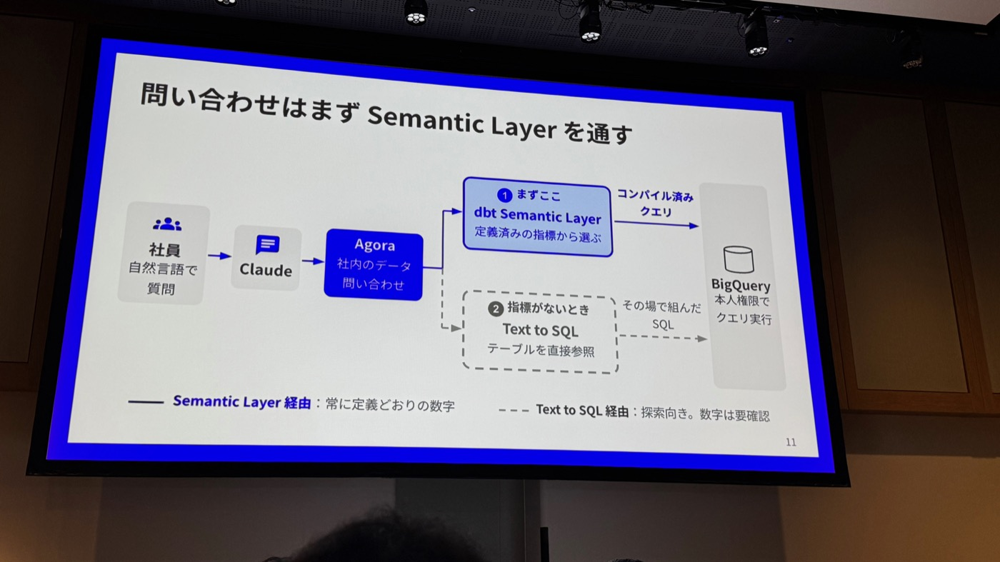
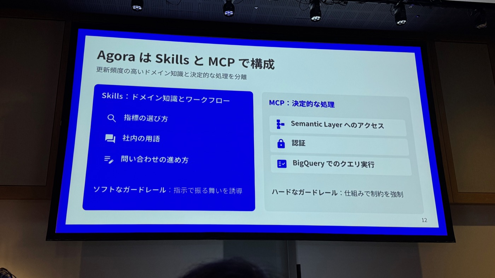
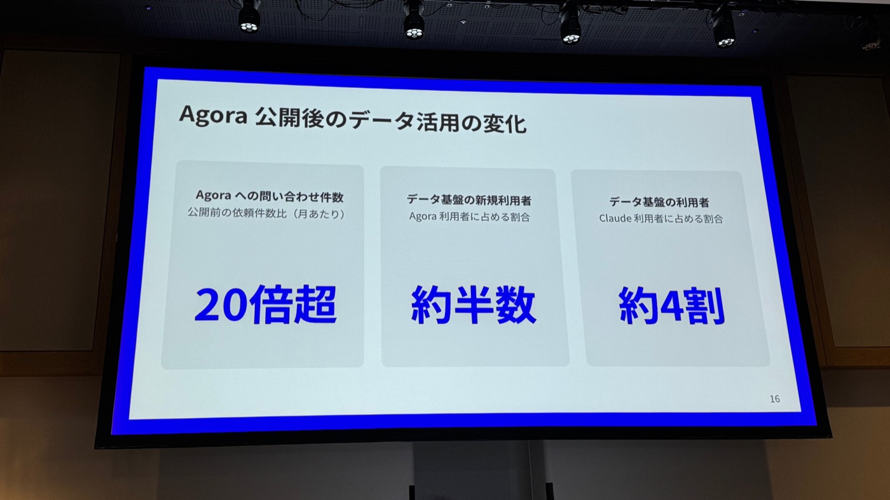
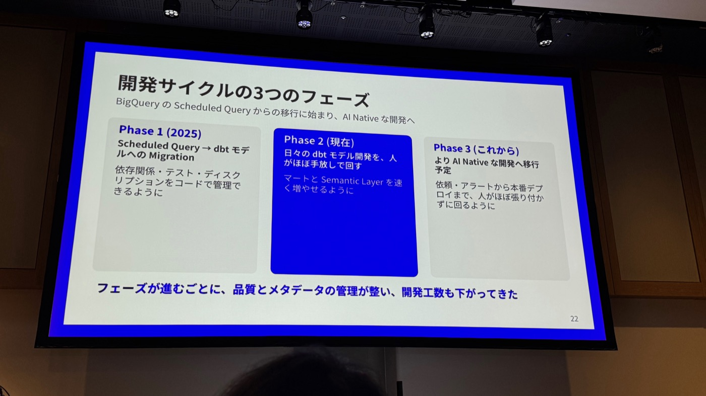


本文為 AI（Claude）協助產出的演講摘要：以現場錄音的逐字稿為底本，並以投影片照片交叉校正人名與數字後整理而成。內容雖經人工確認，仍可能與講者原意有出入，請以官方公開資料為準。


- **場次**：2026 dbt World Tour Tokyo（2026-10-20）
- **講者**：enechain Data Platform Desk　周晟聡（前半）／菱沼拓未（後半）
- **素材**：現場錄音逐字稿（31 分鐘）× 投影片照片 32 張

enechain 是日本最大的電力・燃料・環境價值交易線上市場（eSquare，年交易額超過 1 兆日圓），並提供 SaaS／清算服務（eScan、eCompass、eClear）。Data Platform Desk 負責匯集多個產品資料的資料基盤。

---

## 一、背景：全公司導入 Claude，資料卻還在「排隊等人」

- 公司環境：**業務工具是 Claude（全員日常使用），資料基盤是 dbt platform（模型與 Semantic Layer 定義）＋ BigQuery（資料倉儲）**。
- 傳統的資料活用是「依賴制」：要數字就向資料團隊提單、報表依每次請託用 BI 或試算表個別製作；dbt 遷移後基盤整備完成，但**能自己寫 SQL 直接用資料的人有限**；各事業部的個別請託也讓資料團隊難以排優先序。
- 全公司導入 Claude 後，「先問 Claude」的工作方式定型（做簡報、調查都先交給 Claude）——**那資料也走同一個入口就好**：能直接問 Claude 拿到數字，等待就消失了。

## 二、Agora：社內資料查詢工具

在 Claude（Claude Cowork）裡以 `/agora` 整合呼叫：

- **不用開新工具**：在平常用的 Claude 直接發問（例：「比較上月營收與去年同月」）。
- **連接 Claude 與資料基盤**：收到問題後向 dbt 與 BigQuery 查詢並回覆。
- **回數字也回根據**：併記使用的指標（如 `group_consolidated_revenue`）與時間軸基準；問題含糊時（上月是「成約月」還是「計上月」？）會先確認條件再回答。

### Semantic Layer first 的設計

Text-to-SQL 的問題：**同一個問題每次執行可能回不同數字**——「上月營收」可以是成約月×計上月、連結營收×集團合算營收的任意組合，每種解釋都不算錯，**問題在定義沒有被共享**。因此 Agora 的查詢路徑是：

> 社員（自然語言）→ Claude → Agora → **① 先查 dbt Semantic Layer**（從既定義指標選，產生編譯後查詢）→ BigQuery（以本人權限執行）；**② 沒有指標才用 Text-to-SQL** 直接查表——Semantic Layer 經由＝永遠回定義一致的數字；Text-to-SQL 經由＝探索用，數字需確認。

### Skills 與 MCP 的軟硬 guardrail

**Agora＝Skills＋MCP 構成**，把「更新頻繁的領域知識」與「決定性的處理」分離：

- **Skills（軟 guardrail，以指示誘導行為）**：指標的選法、社內用語、查詢的進行方式。
- **MCP（硬 guardrail，以機制強制約束）**：Semantic Layer 存取、認證、BigQuery 查詢執行。

### Semantic Layer 定義的兩個工夫

1. **把時間軸寫進定義**：聚合用日期固定在定義裡（「上月」＝以計上月計），杜絕每次查詢的解釋差異。
2. **說明文（description）是指標選擇的根據**：Agora 經 API 取得 label・description 來選指標，寫明「**全社營收指的就是這個**」之類的說明可防止選錯（如誤用集團合算營收）。

## 三、選用 dbt Semantic Layer × dbt platform 的理由

- **Semantic Layer**：同問同答（SQL 由定義自動生成、BigQuery 執行、排除解釋搖擺）；指標定義與模型**同一 repository 管理**，活用既有 dbt 資產。
- **dbt platform**：提供 **Semantic Layer API**，自己只需做接續部分，AI・BI 都能利用；開發面則靠 **Fusion・dbt MCP** 加速模型開發（後半主題）。

## 四、成效與學習（投影片數字）

| 指標 | 數字 |
|---|---|
| Agora 查詢件數（對公開前的月請託數） | **20 倍超** |
| 資料基盤「新」利用者占 Agora 利用者比例 | **約半數** |
| 資料基盤利用者占 Claude 利用者比例 | **約 4 割** |
| 資料團隊請託件數 | **約 6 割減** |
| 資料基盤利用者數 | **約 1.5 倍**（增加分幾乎都是 Agora 利用者） |
| Semantic Layer 回答的查詢占比 | **約 3 割 → 約 4 割**（持續從重要指標增加定義） |

**三個 takeaway**：

1. **嵌入平常的業務工具**：不增加新工具，從日常的 Claude 直通資料。
2. **Semantic Layer 聚焦重要指標開發、及早提供**：有 dbt platform API，要做的只有接續部分。
3. **先公開、先計測，再決定整備對象**：公開首日起記錄利用履歷，以實際需求決定優先序——ad hoc 探索維持 Text-to-SQL、重複參照的資料整備成 mart、**定義不容搖擺的指標才進 Semantic Layer**。

## 五、開發循環的三個 Phase（後半：菱沼）

> 從 BigQuery Scheduled Query 的遷移開始，邁向 AI Native 開發。Phase 越往後，品質與 metadata 管理越完善、開發工數越低。

### Phase 1（2025）：Scheduled Query → dbt 模型遷移

- 以前：Scheduled Query 錯開時刻（3:00／3:30／4:00）隱性管理依存關係、屬人化的巨大 SQL、無測試與 metadata。
- 大量 SQL 人工重寫工數太高，把工程拆成 **4 個 Claude Code 指令**協同遷移：

| 指令 | 做什麼 | 人的角色 |
|---|---|---|
| `analyze-bq-query` | 解析既有 SQL 的邏輯・依存 | 確認結果 |
| `plan-migration` | dbt 建模設計 | **常時介入**（設計易被既有 SQL 形狀帶偏，邊對話邊定） |
| `generate-dbt-model` | 生成 SQL・YAML・測試 | **常時介入**（常需請求修正生成的 SQL） |
| `review-migration` | 依觀點別 subagent 審查 | 判斷指摘的採否 |

- 結果：人力介入多、花了工數，但**所有模型與 Semantic Layer 都進入 dbt 管理**（依存關係・測試・description 以程式碼管理）。

### Phase 2（現在）：日常 dbt 模型開發，人幾乎放手

新模型作成、既有模型修正、障害對應、Semantic Layer 定義追加，Claude 自律推進。開發迴圈（人只決定「設計」與「預期外差分的處置」）：

1. **起點**：Slack 收到的依賴／alert，把連結丟給 Claude。
2. **調查**：Claude 用 dbt MCP・BigQuery CLI 自律調查（看 job 執行、切分原因）。
3. **設計**：Claude 出設計案與推薦案，人對話拍板。
4. **實裝**：SQL・YAML・測試幾乎不經人手。
5. **PR・檢證**：Claude 開 PR；dbt 的 CI job build 變更分並與本番資料突合；CI 失敗就自己修了重上；**預期外的資料差分必須等人確認才能前進**。
6. **部署**：approve 必須，人最終 review 後 merge。

**Guardrail 全體像**（Skill 誘導行為，仕組み止住違反）：

- **軟 guardrail＝Skill**（規約與手順寫成 Skill，Claude 只讀任務所需）：
  - 層的責務：staging 模型與來源資料 1 對 1；JOIN・UNION 從 intermediate 模型開始
  - SQL 風格：dbt 官方 Skill 沒有的 BigQuery 式書寫規則（SQL 關鍵字大寫等）
  - 領域用語：社內用語含義（FCA＝燃調等）、產品名表記規則（eSL、eSquare 等）
  - 型：金額用 NUMERIC（不用浮點）等
  - 變更檢證手順：本地檢證 parse → build → test 順序；未變更上游參照本番
  - 障害切分：dbt 錯誤與既知症狀照合，既知用固定對處、未知就追記 Skill
- **領域層設計**（一個領域模型橫跨多產品，哪層寫什麼由 Skill 規定）：
  - **A 層**＝staging：來源資料 1 對 1 整形
  - **B 層**＝`__source_stated`：保持來源值不覆寫，隨時可確認原始資料
  - **C 層**＝`__final`：覆寫來源的補正與衍生計算（約定日補正、營收計算等）
  - **UNION 層**：以 dbt model contract 對齊列與型再堆疊；橫斷處理放最後
- **硬 guardrail＝仕組み**（不可破的規則）：

| 時點 | 機制 | 效果 |
|---|---|---|
| 編輯程式碼時 | Claude Code hooks | 拒絕 staging 層以外參照 source 等層違反 |
| commit 時 | pre-commit | dbt lint＋自製檢查，偵測型・列的偏移 |
| 開 PR 時 | dbt platform 的 CI job | build 模型變更分，確認無執行失敗 |
| 開 PR 時 | 與本番資料突合 | 預期外資料差分，人確認前不得前進 |

### Phase 3（今後）：更 AI Native 的開發

人還離不開的是「**開始・定要件・判斷**」三件事，對策：

1. **開始**（依賴/alert 都要人轉交才啟動）→ Slack 收到 alert／依賴時 Claude 自動開始調查、必要時直接開到 PR。
2. **定要件**（工程師先落要件才交 Claude，小需求常因此流失）→ **資料利用者自己與 Claude 對話做出 spec**，不經工程師就開始開發。
3. **判斷**（差分調查 Claude 做、但意圖與否幾乎都人判斷；部署必經人）→ **把期待結果預先寫進 spec**，Claude 確認整合、滿足即可部署到本番，人只看預期外的部分。

> 今後也要培育「盡量不經人手、快速構築」的開發循環。

---

### 附註：投影片與逐字稿互相校正的紀錄

- **講者姓名**：ASR 僅轉出「周」「菱沼／石沼」，主持人唸的「シュー・アキサト」「アクミ」查無漢字；投影片確認為**周 晟聡／菱沼 拓未**（已回寫逐字稿與講者標籤）。
- **所屬**：ASR 的「データプラットフォームAPL」實為 **Data Platform Desk**（已回寫）。
- **工具名**：正式寫法為英文 **Agora**（ASR 各種變體原統一為アゴラ，已改回 Agora）。
- **B 層名稱**：ASR 的「XANSFORSSTATEDSOR」實為 **`__source_stated`** 層（已回寫）。
- **遷移四指令**：投影片確認為 `analyze-bq-query`／`plan-migration`／`generate-dbt-model`／`review-migration`（已回寫）。
- **UNION 層**：ASR 的「レッツとカカオ」實為「**列と型を**（dbt model contract で揃える）」（已回寫）。
- **數字驗證**：20 倍超、約半數、約 4 割、約 6 割減、約 1.5 倍——逐字稿與投影片一致；投影片另補充 **Semantic Layer 回答占比 3 割→4 割**（逐字稿未清楚聽到）。
- 公司補充資訊（投影片）：enechain 經營年交易額超 1 兆日圓的能源市場 eSquare，另有 eScan・eCompass・eClear 等 SaaS／清算服務。
