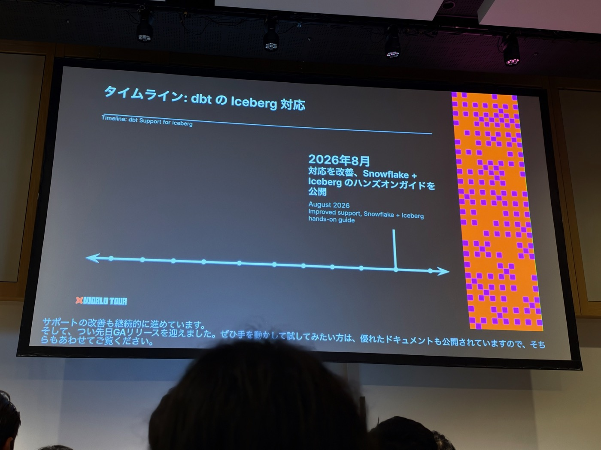
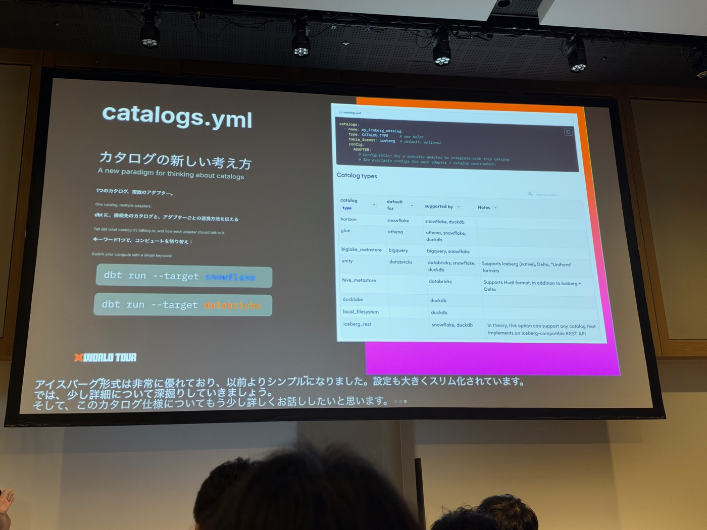
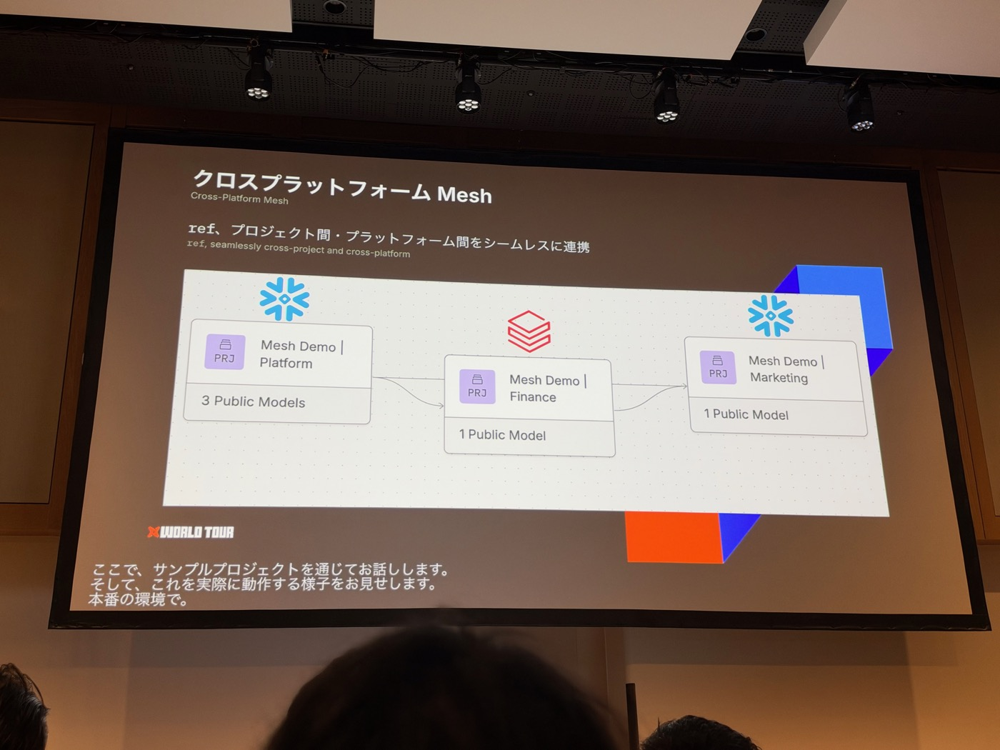
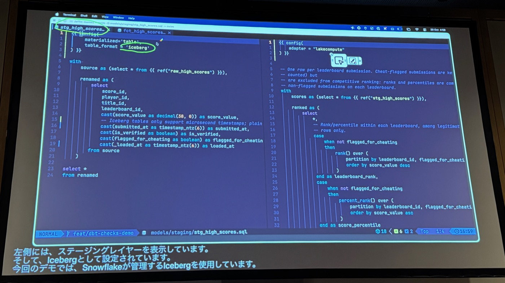


本文為 AI（Claude）協助產出的演講摘要：以現場錄音的逐字稿為底本，並以投影片照片交叉校正人名與數字後整理而成。內容雖經人工確認，仍可能與講者原意有出入，請以官方公開資料為準。


- **場次**：2026 dbt World Tour Tokyo（2026-10-20）
- **講者**：Lee Bond-Kennedy（dbt Labs Director of Solutions Architecture，在 dbt 近 6 年、APAC 區第一號員工，BI 背景出身）
- **素材**：現場錄音逐字稿（35 分鐘，英文演講附日文即時字幕）× 投影片照片 36 張

---

## 一、背景：Table format 是最後一塊被解耦的拼圖

- 多數公司用一到兩座 data warehouse、一到兩個 dbt 專案；大企業雖有多專案，但往往各自為政，看不到專案之間的 lineage——這是本場要解的兩個題目（跨平台、跨專案）。
- Modern data warehouse 的演進：source → bronze/raw → gold，由 BI（Tableau、Power BI）消費，**如今越來越多是 AI agent 在消費這些資料**。
- 過去 table format 是雲端倉庫的「黑盒」：compute 與 storage 可彈性伸縮，但檔案格式是專有的，使用者根本不用（也無法）在意。Spark 雖一直支援 ORC、Parquet、CSV 等開放格式，但各引擎間相容性與功能參差。
- 2021–2022 起 **Apache Iceberg** 興起：開源 table format，卻具備 time travel、partitioning、schema evolution、ACID 保證等現代倉庫該有的能力，且任何支援它的查詢引擎都能以同樣方式讀寫。
- 講者認為「哪個開放格式勝出」的辯論，在 **2024 年 Tabular 被（Databricks）收購**時已定錘：**Iceberg 是業界共識的標準開放 table format**。至此 scalable compute、scalable storage、標準開放 table format 三者到齊。

## 二、dbt 的 Iceberg 支援時間軸（投影片版，比口述精確）

| 時間 | 里程碑 |
|---|---|
| 2025-09 | Snowflake 的 Iceberg table **v2 支援** |
| 2025-12 | 首次 demo：多座 data warehouse 讀取 S3 上同一份 Iceberg 資料（catalog 用 Unity） |
| 2026-01 | **catalogs.yml v2** 初版設計與提案 |
| 2026-04 | 新 spec 進入 **beta**（同時因應 dbt v2 問世） |
| 2026-05 | catalogs v2 支援**回移植（backport）到 dbt v1** |
| 2026-08 | 支援改善＋發布 Snowflake + Iceberg 動手實作指南 |
| 近期 | **GA 正式發布**；官方文件已有各倉庫 × Iceberg 的指南（Snowflake/BigQuery/Databricks/DuckDB） |

入門門檻已極低：在支援 managed Iceberg catalog 的平台上，模型 config 加一行 `table_format = 'iceberg'` 即可將模型以 Iceberg 格式物化。

## 三、新 catalog spec：從「資料平台中心」轉為「catalog 中心」

設計哲學的反轉：與其針對 Snowflake、Databricks、BigQuery、DuckDB 個別設定，不如**以 catalog（Unity、Horizon、Polaris…）為第一級概念**——因為 catalog 才是「告訴倉庫資料檔案在哪」的 metadata 持有者。

- `catalogs.yml` 結構：`name`（自訂的 friendly name）、`type`（catalog type）、`table_format: iceberg`（預設可省略）、底下新增 **adapter 區段**放各引擎專屬設定。
- 官方支援的 catalog type（投影片表格）：`horizon`（Snowflake 預設）、`glue`（Athena）、`biglake_metastore`（BigQuery）、`unity`（Databricks；支援 Iceberg 原生、Delta、Uniform）、`hive_metastore`（另支援 Hudi）、`ducklake`、`local_filesystem`、`iceberg_rest`（理論上相容任何 Iceberg REST API catalog）。
- 範例：`finance_db`（type: unity）之下，databricks 區段指定 `catalog_database`，snowflake 區段指定 `catalog_database: snowflake_cld__finance_db`＋`external_volume: my_s3_volume`＋`auto_refresh: true`——當模型跑在 Snowflake 上，dbt 就知道要走 **Catalog Linked Database** 與該 S3 volume。
- 模型端大幅簡化：只要 `catalog_name = 'finance_db'`，頂層設定全部自動繼承。
- **「選了哪個 adapter，就是選了哪個 compute engine」**：`dbt run --target snowflake` / `--target databricks` 一個關鍵字切換運算引擎。

## 四、跨平台 Mesh demo：Snowflake × Databricks 共用同一份資料

**設定**：三個團隊、三個 dbt 專案組成 mesh——
- **Platform**（Snowflake｜Horizon Catalog）：收 raw 資料（raw_customers/payments/orders），轉成 staging 層，公開 3 個 public models（customers、orders、payments）
- **Finance**（Databricks｜Unity Catalog）：用 platform 資料算每位顧客收益（customer_financials）
- **Marketing**（Snowflake｜Horizon Catalog）：用 platform＋finance 資料預測顧客價值（customer_marketing）

**跨平台 ref 的運作**：Finance 專案中 `{{ ref('mesh_demo_platform', 'customers') }}` 搭配 dbt_utils.star，即使上游表是 Snowflake 建的，compile 時照樣解析出正確的 catalog/schema/table（編譯結果：`_wt_tokyo_horizon.mesh_demo_platform.customers`）。demo 以 dbt v2（終端機顯示 dbt 2.0.8）與 dbt Studio 進行，日常 `dbt build` 排程「無聊地正常跑」——講者強調 data pipeline 就該無聊。

**底層機制（7 步 walkthrough 圖）**：
1. Platform 發布資料表 → 註冊進 Snowflake Catalog，**Iceberg 檔案寫入共用 S3 bucket**（bucket 分 Platform/Finance/Marketing tables ＋ Federation metadata 區）。
2. **Databricks 用 catalog federation** 建立 Federated Snowflake Catalog：Platform catalog 的即時視圖——metadata 留在 Snowflake、表資料直接從 storage 讀，**零複製**（Databricks 端可看到 Type: Foreign、Connection: Snowflake 的外部 catalog）。
3. Finance 在 Databricks 上建 customer_financials → 註冊進 Unity Catalog、Iceberg 檔寫回同一個 bucket。
4. **Snowflake 用 Catalog Linked Database** 掛上 Linked Databricks Catalog（Finance catalog 的即時視圖），Marketing 因此能讀 Finance 的表。
5. 最終格局：**一個 storage layer、一種 table format、多個查詢引擎讀寫同一份資料**；某平台寫入的 metadata 立即出現在另一平台，反之亦然。

**Public model 概念**（mesh 的關鍵）：在 YAML 把模型標成 `public` 並指定 owner——public 不代表對外公開，**使用者仍需有資料平台上的實際權限**；它代表其他 dbt 專案「看得見、ref 得到」這個模型。

**Trade-offs（講者坦承）**：比單一平台＋managed catalog 費工——要建 catalog-linked database、設 catalog federation、管多個 catalog，還有**寫入較慢與讀取時效性（stale reads）**的代價；但整合一次設好之後，日常開發與單純的 dbt mesh 幾乎無異。價值是**大幅減輕查詢引擎的 lock-in**。

## 五、Lake Compute：讓架構更簡單的下一步

- **Lake Compute** ＝ dbt Labs × Fivetran 的 managed compute engine（private beta）：**DuckDB 架構的單節點 SQL 引擎**，用 **Polaris** 作 catalog，直接對 Iceberg 表跑 dbt 轉換。
- 搭配 **Fivetran MDLS（Managed Data Lake Service）**：Fivetran 把 raw 資料**直接以 Iceberg 格式寫入 object storage 的 staging 層**（不再先進專有格式再轉檔），dedup、compaction、merge、CDC 都由 Fivetran 處理，資料一落地就註冊進 catalog，倉庫或 Lake Compute 立即可用。
- **設定反而更少**：因為 MDLS 自帶 catalog，**catalogs.yml 可以是空的**；只要在 profiles.yml 加一個 output（demo 實際設定：`type: lakecompute`、`method: fivetran`、`fivetran_credential: "{{ env_var('DBT_LC_KEY') }}"`——單一 token 認證）。
- **按模型指定引擎、不需 mesh**：上游 staging 模型 `table_format='iceberg'`（demo 中由 Snowflake 管理），下游 fact 模型 config 加 `adapter = "lakecompute"`——同一個專案內，不同模型跑在不同 compute 上。demo：stg_high_scores 由 Snowflake 建、fct_high_scores 由 Lake Compute（DuckDB）建，共用同一 storage 與 format，最後用 `dbt show --adapter lakecompute` 直接預覽資料——**全程沒動用 data warehouse**。

## 六、結語：Open Data Infrastructure（ODI）

雲端倉庫完成了 storage 與 compute 的解耦；現在正發生的是 **table format 的解耦**。開放標準讓資料堆疊的各元件變得可插拔（pluggable），人與 AI agent 都能以可擴展、受治理、高效率的方式消費資料——所有 compute engine 原生支援、把開放 table format 當一級公民。這就是一年前提出、今日逐步落地的 **Open Data Infrastructure** 願景。

---

### 附註：投影片與逐字稿互相校正的紀錄

- **講者名**：使用者原確認「Lee Bond Kennedy」，demo 畫面（dbt 帳號選單、Databricks owner `lee.bond.kennedy@dbtlabs.com`、終端機 `lee@Lee-Bond-Kennedy`）確認正確拼法為 **Lee Bond-Kennedy**（連字號），已回寫逐字稿與講者標籤。
- **時間軸**：口述「九月加入 Databricks 支援、十二月 demo」經投影片校正為：2025-09 是 **Snowflake Iceberg v2 支援**、2025-12 demo、2026-04 新 spec beta、2026-05 backport 到 v1、2026-08 改善＋指南、近期 GA。
- **adapter 名稱**：口述的「adapter equals late compute」實際設定為 `adapter = "lakecompute"`（一個字）；profiles 的 type 也是 `lakecompute`、method 為 `fivetran`。
- **demo 專案**：Lake Compute demo 用的正是 **Jaffle-Games** 專案（與 dbt Wizard 場同一示範宇宙）；mesh demo 專案為 mesh_demo_platform/finance/marketing，Databricks 端外部 catalog 名 `_wt_tokyo_horizon`。
- **「slow writes and stale reads」**：trade-offs 投影片明列、口述未完整帶到，已補入摘要。
- 相簿中 IMG_7573–7576 四張（roadmap、AI loop、bottleneck）實為前一場 dbt Wizard 的投影片，未納入本摘要。
