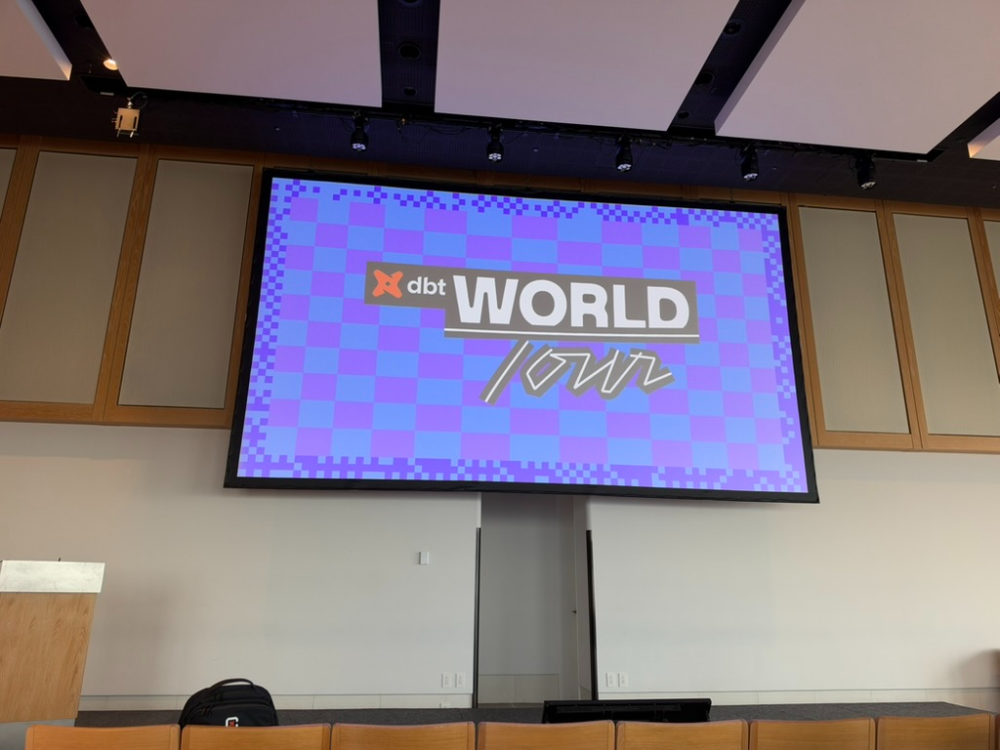
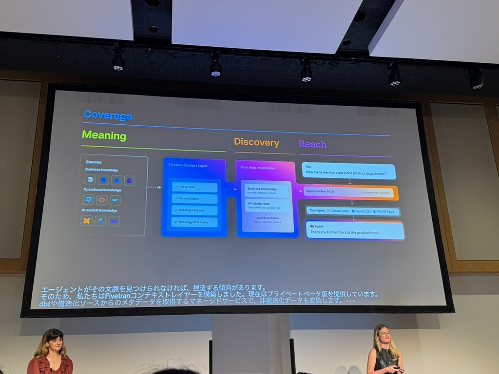
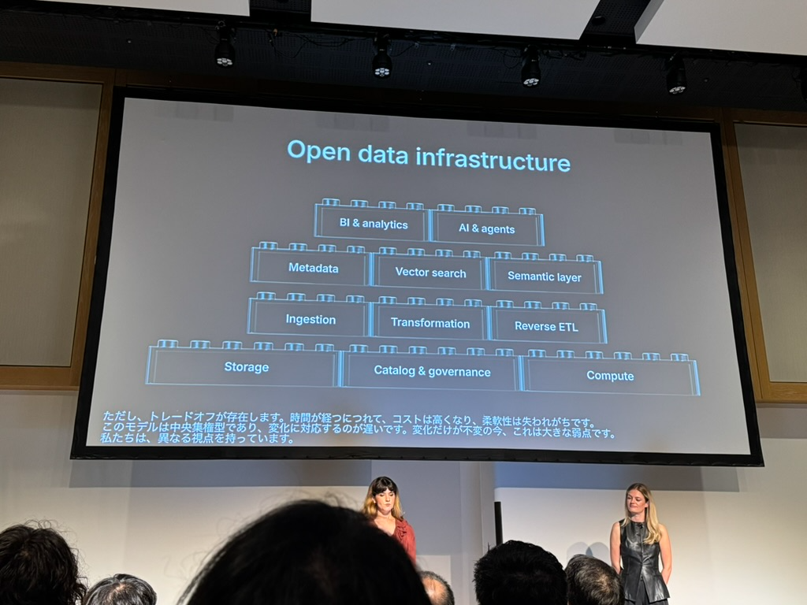
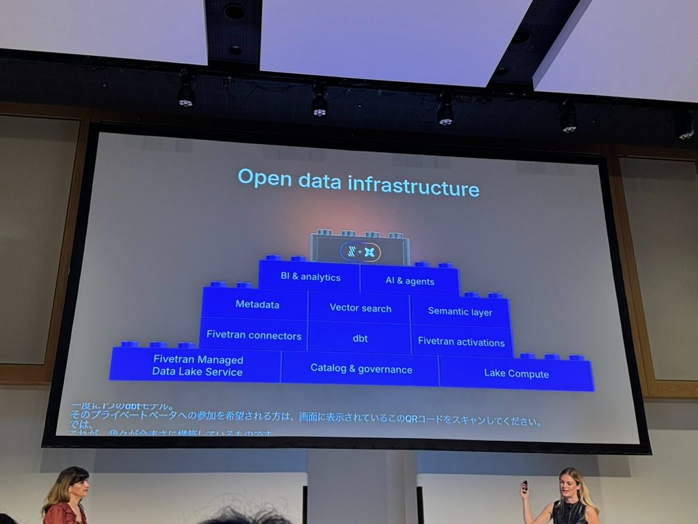
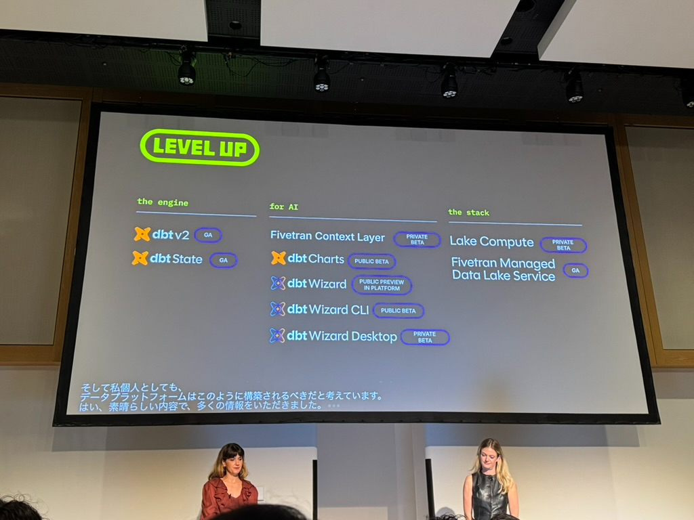

## 簡介

上個月，我參與了dbt World Tour在東京的活動。該活動有七個session，包含官方的新功能發表、受邀企業的經驗分享等等。作為長期關注dbt發展的資料工程師，自然是不能錯過這個重要的活動。今年的主題包含**dbt v2 GA**、**dbt Wizard (AI teammate)**以及**Open Data Infrastructure**。

如果讓我簡單一句話總結，那就是「有去參加實在是太好了」。

## 大會主軸 － dbt v2 &「Level Up」

這次dbt v2對官方來說是一個非常重要的里程碑。在生成式AI的浪潮之下，對資料工程領域產生非常多深遠的影響。作為一個在現代資料工程中的重要工具，dbt也在dbt v2中，展現了屬於他們在這個時代的一張答案卷。基本上可以用三個大方向來總結：「The Engine(dbt v2)」、「Level Up for AI Agent」以及「The Stack (Open Data Infra)」。接下來我們會一一介紹這三個部分。

### dbt v2

dbt v2在今年Las Vegas的dbt Summit發表，核心差異在於：完全使用Rust重寫dbt的所有架構，在重寫後，以往的dbt Core以及dbt Fusion已經被合併為一個統一的架構。首波以支援大部分的主流OLAP資料庫，包含GCP BigQuery、AWS Redshift、Databricks、DuckDB以及Snowflake，後續也將支援Athena、Microsoft Fabric以及PostgreSQL等等資料庫。

同時，在dbt v2中，也加入了全新的功能——「dbt State」。過去在 dbt 1.x 時代，每次 dbt build 都會把所有模型重新建置一次，即使程式碼和資料都沒有變更。dbt v2 透過導入狀態機制，自動偵測變更，讓沒有被更動到的模型（連同測試）在建置階段直接跳過。官方在live demo中展示，一個原本需要花20秒的dbt build，啟用 dbt State 後 12 秒就能夠完成。

### Level Up for AI

在與Fivetran合併之後，Fivetran也被納入了這波dbt v2的生態系中。資料工程的一大目標就是建立「能夠被信任的資料架構」，而dbt v2對此交出的答案卷就是「Fivetran Context Layer」、「dbt Charts」以及「dbt Wizard」。

* Fivetran Context Layer要解決的問題是：AI Agent找不到context時會自己亂編造說法。Fivetran Context Layer把dbt專案結構、metadata，以及散落在各處的非結構化知識，轉換成Agent容易搜尋、理解的形式，讓Agent對Data Infra以及整個資料架構有更完整的理解，提升Agent運作的準確性以及效率。

  

* dbt Charts是在補齊過往dbt生態系中，缺乏「提供決策的圖表」的這部分。過去由於dbt沒有提供圖表功能，導致資料工程團隊需要用其他的工具來進行視覺化以及圖表製作，這造成了資料的生命循環以及決策圖表的斷鏈。dbt Charts將提供圖表製作的功能，讓圖表的定義與資料處理的定義能夠被放在同一個專案底下，提升專案知識管理的集中度。

* dbt Wizard是dbt為analytics engineering 打造的 agent。dbt Wizard提供橫跨models、lineage、contracts、tests、semantic layers的分析以及工程協作，讓資料工程師可以使用dbt Wizard進行調查到驗證為止的端到端資料工程協作。同時dbt Wizard也提供**Explore Mode**讓業務以及分析使用者可以使用自然語言提問，來從資料工程專案中獲取業務分析或是資料工程的know-how。

### The Stack - Open Data Infrastructure

在與Fivetran合併之後，dbt很明確地展現出對整個資料生態系的野心。在過往的資料工程架構中，各個架構往往是分散的，缺乏一個可以從基礎到應用端都能夠完全包含的服務。

在本次發表中，dbt提出了Open Data Infrastructure的概念，並針對每一個階段都提出了自己的解決方案。無論是計算（Lake Compute/Managed Data Lake Service）、管理（Catalog）、分析（Semantic Layer/BI/Analytics）以及最後的生成式AI協作（dbt Wizard），都有了對應的計劃以及產品。

在Open Data Infrastructure方面，dbt v2也公布了他們針對Iceberg以及Data Lakehouse的支援。在dbt v2中，使用者可以透過新的`catalogs.yml`設定來宣告catalog：先指定catalog類型（Unity、Horizon、Polaris等），再於其下為各個adapter（Snowflake／Databricks／BigQuery）加上連接該catalog的對應設定。如此一來，dbt就知道「不管模型在哪個引擎上執行，該怎麼跟這個catalog溝通」。

這帶來的直接效果，就是串聯在不同雲端服務中運作的Data Lakehouse：無論是Databricks的Unity Catalog，還是Snowflake的Horizon Catalog，都能被整合到同一條dbt管線中，建立跨Lakehouse的ELT管線。官方把這個轉變稱為從「平台中心」轉為「catalog中心」——在真正意義上讓dbt完整支援了Data Lakehouse的生態系。

對企業來說，這也意味著可以擺脫對於Data Lakehouse的Vendor Lock-in焦慮，不用再被一間公司的解決方案給綁住。

### Level Up 總結

在官方的Level Up簡報中，針對dbt v2在生成式AI的年代給出了他們的各種解決方案，而這些方案我想無論對於資料工程師、資料分析師來說都是非常重要的功能。如果有機會可以導入，我想肯定能讓資料團隊整體的效率以及資料管理上的程度更上一層樓。

## 個人心得

不得不說，在聽完官方的所有發表後，個人是非常興奮的。這次的dbt v2解決了很多既有在使用dbt 1.x的痛點，無論在效率、管理以及協作上都能夠有所提升，這真的讓人非常躍躍欲試。同時，這些功能的發表，也代表dbt在接下來的發展上，不再只是單純的「資料工程」的工具，成為了資料生命週期中，每一個階段都能夠使用的工具。要是有機會，真的想直接把手上的dbt專案都著手升級到dbt v2，然後開始考慮更進一步新專案發想。

另外，這次七場演講我都有整理詳細的摘要（由AI協助產出、經人工確認），請見文末的系列文章清單。