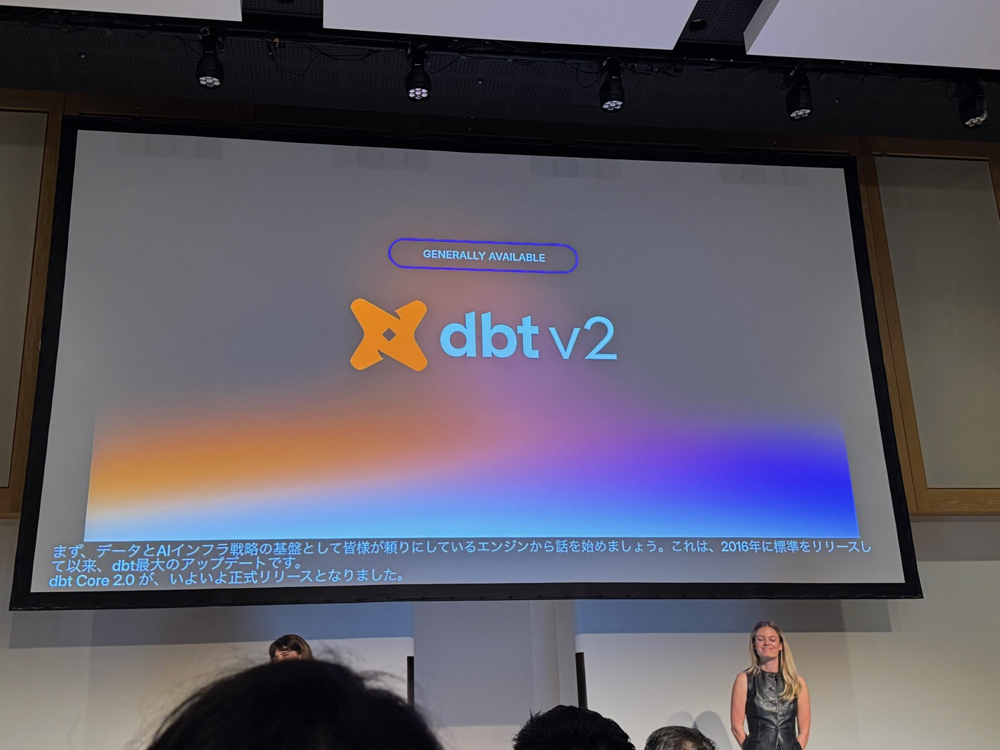
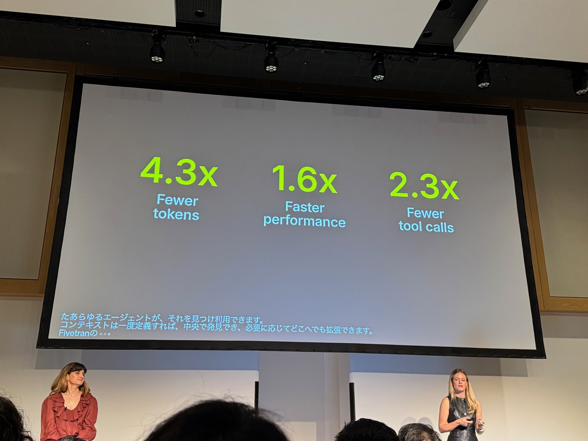
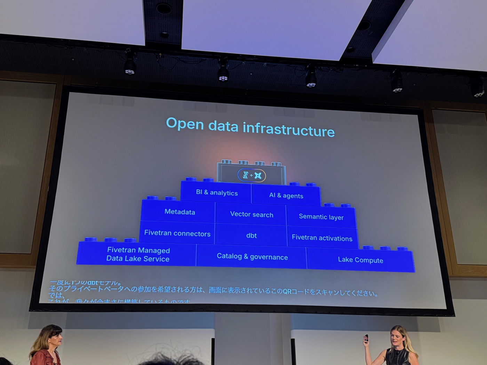
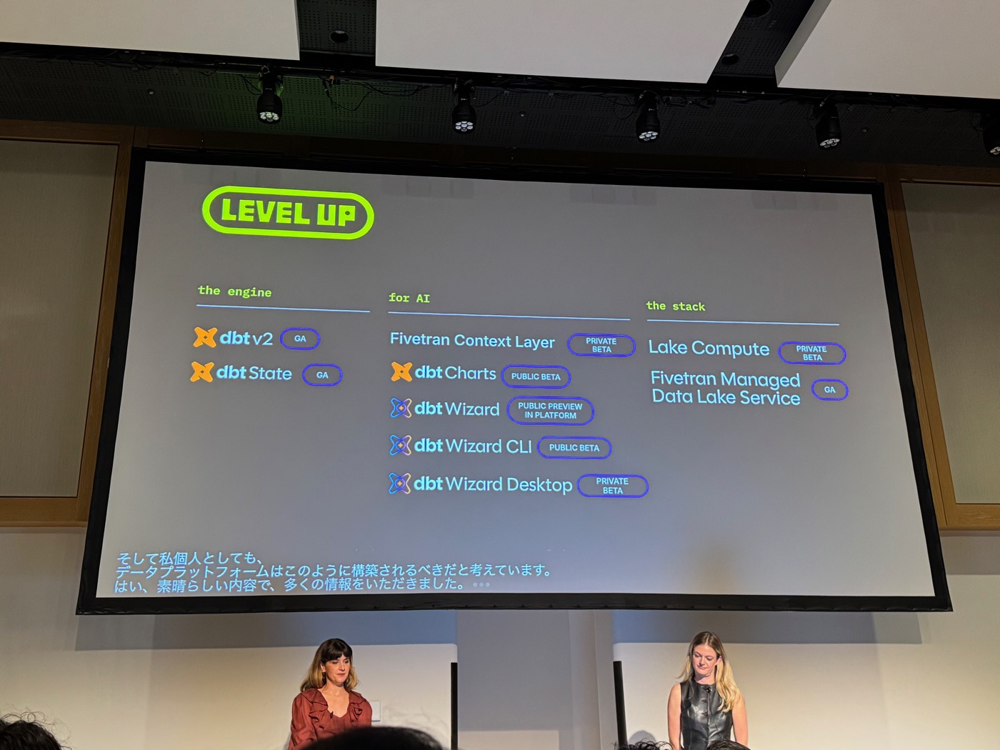


本文為 AI（Claude）協助產出的演講摘要：以現場錄音的逐字稿為底本，並以投影片照片交叉校正人名與數字後整理而成。內容雖經人工確認，仍可能與講者原意有出入，請以官方公開資料為準。


- **場次**：2026 dbt World Tour Tokyo（2026-10-20）開場 keynote
- **講者**：Alexis Jones（VP, Product Marketing, dbt Labs）× Nina Anderson（Director, Partner Solutions Architecture, dbt Labs），英語演講（現場提供 AI 即時翻譯字幕）
- **素材**：現場錄音逐字稿（20 分鐘）× 投影片照片 20 張

---

## 一、這一年，產業變了多少

- **AI 營收**：12 個月內從約 $60B 成長到超過 **$180B**（3 倍）。
- **Agent 能力**：一年前 agent 以 80% 成功率連續作業約 30 分鐘，現在是 **3 小時**——成長呈指數。
- **AI 運算容量**：全球以每年 3 倍成長，現達 **1,710 萬張 H100 等效**。
- **Agentic internet 已至**：Cloudflare Radar 數據——網路流量 **Humans 41.5% vs. Agents 58.5%**，多數流量已非人類。
- 同樣的相變將發生在資料上：**agent 將成為 metrics、tables、metadata 的主要消費者**。這是好事——「從資料產出 insight」一直是資料界最大的瓶頸（誰沒做過一次也沒被用過的 model？塞住 pipeline 的那些節點不是惡意或無能，而是組織自古以來產出的資訊永遠多於能行動的量）。未來不是人提問、agent 研究，而是 **agent 提問、agent 直接依結果行動**——這讓在座所有人做的資料工作前所未有地有價值。
- 所以今年 World Tour 主題是 **Level Up**：從業者、領導者、技術生態系都要升級。dbt 也在升級——三大支柱。

## 二、支柱一：The Engine — dbt v2 正式 GA

- **2016 年發布標準以來最大的 release**：以 **Rust 完全重寫**，為大規模提速、為 AI 就緒（real-time feedback、AI-ready metadata、parse/runtime 最佳化）。
- **兩引擎時代結束**：過去兩年 Fusion 與 dbt Core 並行、維護兩套 codebase 的代價由工程團隊與使用者共同承擔；v2 把 Fusion codebase **整併進 dbt 標準**——一個引擎、一套語言規格，就叫 **dbt**（Fusion 與 dbt Core 品牌將退役）。核心持續以 **Apache 2.0** 授權。
- **成熟度**：近兩年、近 3,000 issues 關閉、10,000+ PR 合併、500+ 功能、與 dbt Core 完全功能相容；**13,000+ 週活躍專案**在 v2 上執行，**40%+ 的 managed 客戶**已在 v2 跑生產 workload。
- **Adapter 狀態**：GA——Amazon Redshift、BigQuery、Databricks、DuckDB、Snowflake；Beta——ClickHouse、Spark；Coming soon——Amazon Athena、Microsoft Fabric、PostgreSQL。
- **dbt State 也 GA**：更智慧的 job orchestration 新典範——code 與上游資料沒變就跳過模型，**節省 15–30% compute**；v1、v2、platform、Airflow、甚至 Snowflake dbt projects 原生整合都能用。（下午有專場深入。）

## 三、支柱二：Level Up for AI

在座每個人多年來做的是同一件事：讓人能信任資料（定義、contracts、測試、semantic layers）。這些工作不會消失，賭注變了——agent 成為資料產品的主要消費者，**你不再只是建模型，你在打造整個組織與其 agents 依賴的 context**。三個新作品：

1. **Fivetran Context Layer**（Private Beta）：agent 需要的不只是模型——還有 wiki、支援 ticket、Slack 討論串這些沒人整理的非結構化知識；**找不到 context 的 agent 會自己編**。這是一個 managed service：匯入 dbt 與結構化來源的 metadata、把非結構化來源轉成 agent 可搜尋的資料，全部以**符合 open spec 的表**存在你的 warehouse 裡——任何有 SQL 權限的 agent、任何 MCP 都能發現並使用（Agent Context MCP＝one governed connector，支援 Claude Code、Gemini CLI、AG-UI apps 等）。對比 off-the-shelf MCP 的實測：**token 消耗少 4.3 倍、速度快 1.6 倍、tool call 少 2.3 倍**。目前與 design partners 共建中。
2. **dbt Charts**（Public Beta）：要解的問題是「人實際用來做決策的圖表，與產生它的程式碼是斷開的」。dbt Charts 是 open spec——**圖表與 dashboard 以 YAML 定義，就放在它描繪的模型旁邊**：同一個 repo、同一個 PR、同一套 CI。
3. **dbt Wizard**：為 analytics engineering 打造的 agent，跨 models、lineage、contracts、tests、semantic layers，從調查一路做到驗證。**Platform 版 Public Preview 對所有團隊開放，dbt plan 用戶免費內含**；新的 **Explore Mode** 讓業務使用者用自然語言提問、答案根植於實際的 dbt project（不需維護另一份同步的邏輯副本）；另有 CLI（Public Beta）與全新 Desktop app（Private Beta）。

## 四、支柱三：The Stack — 開放的資料基礎設施

- **垂直整合的誘惑與代價**：今日最成功的資料平台越來越垂直——想一手包辦你的 storage、compute、metadata、agent 服務，end-to-end。這是門好生意、整合也確實能簡化，但 trade-off 是**隨時間越來越貴、越來越不彈性**；中央集權模式應變慢——在「變化是唯一常數」的時代是致命傷。錯誤技術決策與 vendor lock-in 的代價從未如此高。
- **dbt × Fivetran 的哲學：Lego bricks**——易拼易拆。讓體驗在每個資料平台、每個來源、每個模型供應商之間保持一致，是他們每天在解的難題。客戶應該既能買整合好的開箱方案，也能用高品質、真正開放的介面與開源元件自行組裝。
- **積木盤點**：現代化的轉換標準（dbt v2）；給 agent 與 dashboard 的可信 context（Context Layer、dbt Wizard、dbt Charts）；**750+ Fivetran connectors**；開放儲存——**Iceberg** 作為 primitive ＋ **Fivetran Managed Data Lake Service**（GA）；開放運算——**Lake Compute**（Private Beta）：DuckDB 架構、輕量可攜，在 v2 上可部署於任何支援 Iceberg 的資料平台旁，**以單一 dbt model 為粒度**選擇適合的 compute。
- 這個平台既是過去十年垂直平台的**補充**，也是**替代**——「我們相信這是未來資料平台被建造的方式，我個人認為，這也是它*應該*被建造的方式。」（Nina）

## 五、總結（投影片）

| 支柱 | 發布 | 狀態 |
|---|---|---|
| The engine | dbt v2 | **GA** |
| | dbt State | **GA** |
| For AI | Fivetran Context Layer | Private Beta |
| | dbt Charts | Public Beta |
| | dbt Wizard | Public Preview in Platform |
| | dbt Wizard CLI | Public Beta |
| | dbt Wizard Desktop | Private Beta |
| The stack | Lake Compute | Private Beta |
| | Fivetran Managed Data Lake Service | **GA** |

結尾交棒給 Elias DeFaria 進行 demo。

---

### 附註：投影片與逐字稿互相校正的紀錄

- **講者**：Nina Anderson 的頭銜，主持人唸「シニアマネージャー」，投影片為 **Director, Partner Solutions Architecture**（已依投影片修正）；「ニナ・アンダンソン」→ニナ・アンダーソン；「DBTラウス」→dbt Labs。講者分配：Speaker 2＝Alexis（引擎與 stack 批判）、Speaker 3＝Nina（AI 支柱與 Lake Compute），由「Alexis and I」一句定錨。
- **產品名**：ASR 的「Fire Trend Context layer」「5-time context layer」實為 **Fivetran Context Layer**；「Open Compute R3, Blake」「Blake Compute」「light compute」實為 **Lake Compute**；「DUPDB」→DuckDB；「iSprk」→Iceberg；「DBT4」→dbt Core；「B2」→v2。
- **數字**：Cloudflare 比例（41.5%／58.5%）、4.3×／1.6×／2.3×（Context Layer vs off-the-shelf MCP）為投影片數字，逐字稿只有定性描述；$60B→$180B、30 分鐘→3 小時、17.1M H100、3,000 issues／10,000 PRs／500 features／13,000 專案／40% 與投影片一致。
- **狀態標籤**：九項產品的 GA／Beta 狀態以總結投影片為準（逐字稿中「now in private data」實為 private beta）。
