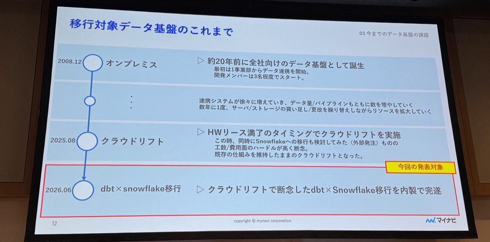
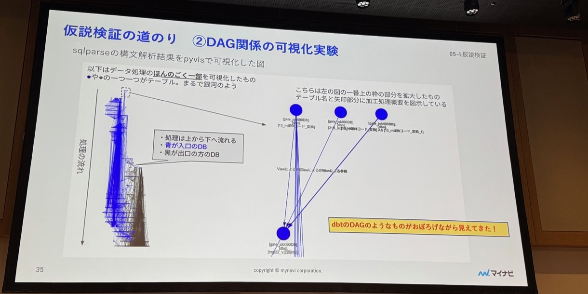
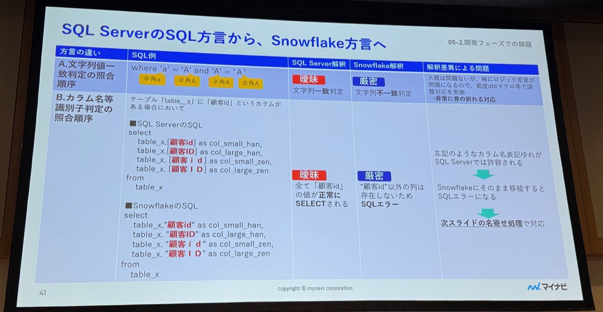
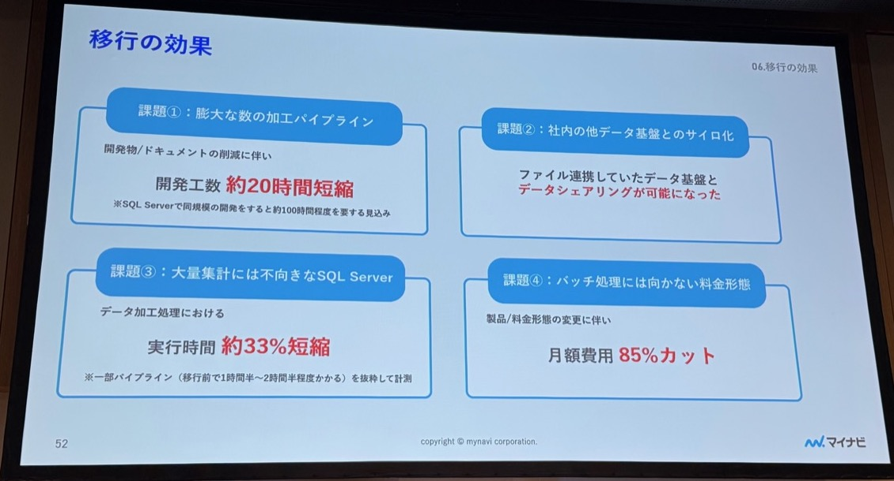


本文為 AI（Claude）協助產出的演講摘要：以現場錄音的逐字稿為底本，並以投影片照片交叉校正人名與數字後整理而成。內容雖經人工確認，仍可能與講者原意有出入，請以官方公開資料為準。


- **場次**：2026 dbt World Tour Tokyo（2026-10-20）
- **講者**：株式会社マイナビ（Mynavi）デジタルテクノロジー戦略本部 データエンジニアリング部 — 寒河江さん（新卒 10 年目、與基盤相伴最久）、飯田さん（2022 年新卒入社、5 年實務）、照井さん（二度入社的「出戻り」，經歷 SIer → AI 開發 → SaaS 後回歸）
- **素材**：現場錄音逐字稿（36 分鐘）× 投影片照片 43 張

---

## 一、背景：20 年「秘伝のタレ」資料基盤

マイナビ是以人力媒合（マイナビ2026 新卒、マイナビ転職、打工等）為核心的多服務企業——企業端付費刊登、求職者端免費使用的 matching business。服務多、系統各自橫向展開，資料量與管線數隨事業數膨脹：服務網站資料（PV、刊登資訊）＋基幹系統（ERP／SFA/CRM／會計）＋其他資訊系統（行程、ID、檔案管理）全部匯入一座全社 DWH。

基盤年表（投影片）：
- **2008.12**：On-premises 誕生（最初 1 個事業部、開發 3 人起步），之後連攜系統漸增，數年一次買伺服器／儲存擴容，「繼ぎ足し繼ぎ足し」熬了近 20 年
- **2025.08**：硬體租約到期之際實施**雲端 Lift**（同時外包評估過 Snowflake 化，因工數／費用門檻過高含淚放棄，僅原樣搬上雲）
- **2026.06**：本場主題——被放棄的 dbt × Snowflake 移行**以內製完遂**

## 二、四大課題

1. **View＋Stored Procedure 堆出的巨量加工管線**：一個 mart 要疊多次「View 加工 → Stored Procedure INSERT」。Procedure A→B→C 的執行順序**靠人工在 Job 制御工具裡設定**（錯排就出事故）；依存關係靠一份巨大的 **Excel 文件**人工維護。規模：Job 制御設定約 3,000 條、bat 檔約 6,800 支、procedure 約 3,000 支。
2. **與社內其他資料基盤的孤島化**：全社 DWH 之外還有各事業部 DWH，彼此只能靠檔案連攜。
3. **SQL Server 不擅大量集計**：OLTP 強、OLAP 弱，資料量增加後加工耗時顯著，只能堆硬體（成本膨脹）或縮小集計範圍（犧牲運用）。
4. **計費模式不合批次型工作負載**：雲 Lift 後的 DWH 按「啟動時刻」計費，批次集中、閒時也得開機，白花成本；自動啟停又難處理不規則排程，反成運用負擔。

## 三、為何選 Snowflake × dbt

- **DAG 結構管理管線**（解課題①）：dbt 自動解決執行順序——3,000 條 Job 設定、6,800 支 bat、3,000 支 procedure **全數不再需要**；lineage 從 SQL 自動可視化，巨型 Excel 文件也退役。
- **Data Sharing**（解課題②）：各基盤都上 Snowflake 後跨帳戶互相參照，大幅化解孤島。
- **OLAP 資料庫**（解課題③）：大量集計快、Scale up/out 容易；移行前實驗中**曾有 2 小時以上的 SQL 縮到約 10 分鐘**。
- **合批次的計費**（解課題④）：運算與儲存分離、warehouse 只在稼働時間計費，貼合批次集中的負載型態。

**選 dbt platform 而非 dbt Core 的理由**：①免調度／管理執行基盤（full-managed，專注變換邏輯）②執行狀況可視化（錯誤位置、各模型處理時間 timeline）③ **CI**——GitHub 開 PR 即自動測試，不過測不能 merge ④ dbt Labs **日語官方技術支援**。

## 四、內製移行：假說檢證（照井主講）

外包估價的教訓：多數廠商連概算都算不出來，唯一報價的是**數十億日圓等級的巨額**（投影片遮蔽為「〇〇億円」，講者口述約 40 億）——因為廠商只能用「開發物數量 × 單價 × 人月」掛け算。開發物總量：**Stored Procedure 6,843 支、Table 30,844 個、View 15,584 個、報表 1,574 個**。

照井回鍋後向寒河江確認，發現關鍵事實：所有加工基本上都是「**ストアド → View 的 SELECT → 對表 INSERT INTO SELECT**」的重複——**這不就和 dbt 的構成同構嗎？** 於是立三個假說逐一驗證：

| 疑慮 | 驗證結果 |
|---|---|
| Stored Procedure 能構文解析嗎？（而且表／欄名是日文） | Python 的 **sqlparse** 做 token 分割＋巢狀結構解讀，抽出識別子——**可行** |
| 只靠ストアド內「A→B」能重現 lineage 嗎？ | **pyvis** 把解析結果畫成圖（密得像銀河），請運用中的同仁視覺核對、補漏——**可行** |
| 只靠ストアド＋View 能生成 dbt model 檔嗎？ | sqlparse 抽出表名合成 `{{ ref('表名') }}`，自動產出 model 檔——**可行** |

結論：**既有管線可以機械式轉換成 dbt 原始碼**，從「掛け算報價」的絕望中找到出路。

## 五、開發期課題：SQL 方言與「名前の揺れ」（寒河江主講）

自動生成只解決了骨架，異產品 DB 移行的通病仍在：

- **方言差**：全形欄名引用 `[列X]`（SQL Server）vs `"列X"`（Snowflake）；字串比對與識別子照合順序**寬鬆 vs 嚴密**（半形 a＝全形Ａ 在 SQL Server 判一致、Snowflake 判不一致）；Date 字面值 SQL Server 認多種格式、Snowflake 原則只收 `YYYY-MM-DD`；函數差異則逐一對應。稀少的邏輯差異用 dbt macro 個案調整——「非常骨折れる（吃力）」的人工對應。
- **日文表／欄名的「名前揺れ」**：人寫的 SQL 裡「顧客id／顧客Id／顧客ＩＤ…」在 SQL Server 全都通，搬到 Snowflake 直接 SQL error。對策：在構文解析流程掛一個 **Python 字典做名寄せ**（顧客id、顧客Id、顧客ＩＤ → 顧客id），自動統一後再生成 dbt 檔。

結論（投影片原文）：SQL Server → Snowflake 移植**充分可行**；但若用日文表欄名，識別子名寄せ會很辛苦，請先有心理準備。

## 六、管線移行的三大課題（飯田主講）

As-Is：各系統（SQL Server/Oracle/MySQL）＋檔案（csv/txt/xlsx）→ 兩種 ETL 工具 → SQL Server（View＋ストアド）→ 定型 BI／檔案配布／自助 BI（Tableau、Power BI）。To-Be：抽出變換改 **Python 工具＋Amazon S3＋ETL 工具**，加工蓄積改 **Snowflake＋dbt**，全部 **GitHub** 管理。實際動手後「一筋縄ではいかなかった」：

1. **ETL 寫入目的地變更無法自動化**：對象腳本約 **1,400 支**、工具限制同時作業人數、開一支要數分鐘、構成依存度高到連換工具都不可行。對策：先列清單剔除不要的、能改用 dbt 的改掉，**對象減到 840 支**再分工手改。
2. **ETL 寫入 Snowflake 慢到不可用**：查執行履歷發現是對數萬～數十萬筆資料反覆 **INSERT INTO**。對策：自製 Python 工具改走 **檔案化 → 外部 Stage → COPY INTO**，恢復與移行前同等的寫入時間。
3. **資料一致確認範圍膨脹**：原定只驗最終表，但追差異要一層層往上游溯源，最後 **Snowflake 中間表 3,600 個**全要驗（另有使用者 mart 260 個、BI 用 DB 600 個）。對策：整理驗證觀點分級——中間表只驗**件數一致**（取數自動化、Python 輔助），使用者 mart 與 BI 用 DB 驗到**資料內容一致**——驗完才放行上線。

## 七、移行成效（對應四課題）

| 課題 | 成效 |
|---|---|
| ① 巨量加工管線 | 開發物／文件大幅削減，**開發工數縮短約 20 小時**（同規模開發在 SQL Server 上估約需 100 小時） |
| ② 資料孤島 | 原本只能檔案連攜的基盤之間**Data Sharing 可用** |
| ③ 大量集計效能 | 資料加工**執行時間約縮短 33%**（以移行前需 1.5–2 小時的部分管線抽測） |
| ④ 計費形態 | **月額費用削減 85%**（改為稼働時間計費） |

## 八、今後展望（時間軸）

ETL 工具內的加工處理搬進 dbt（取込歸 ETL、加工歸 dbt 的分工）→ **Streamlit** 活用（讓使用者直接輸入資料的 app 已在推進）→ **Iceberg** 資料連攜（對非 Snowflake 的基盤也能共享，準備中、不久後上線）→ **dbt test 與 Fusion（dbt v2）導入**（test 已部分導入）→ **Terraform 導入**（基礎設施／資源改 code 管理）→ **表名・欄名英語化**（dbt 化後變得容易動手）。

## 九、總結：20 年巨量資產移行成功的三個理由

1. **活用既有資產來提效**——解析既有 SQL／ストアド，把它們變成移行的原料，而非從零重寫。
2. **以自動化解決物量**——構文解析＋自動變換，正面迎戰數萬個 object。
3. **自動化不了的地方用工夫減量**——現場遇到預期外課題時（老成員＋新成員協力）靠剔除、分級、工具化把作業量壓下來。

移行不只實現了成本削減，更換來一座**能跟著變化長久育成的資料基盤**。

---

### 附註：投影片與逐字稿互相校正的紀錄

- **講者姓氏**：ASR 轉成「佐賀江」，投影片（「当社寒河江に確認したところ」）確認為**寒河江**（さがえ），已回寫逐字稿與講者標籤；「照井」獲投影片佐證（「照井再入社前の話」），「飯田」無投影片可對、維持原轉錄。
- **sqlparse／pyvis**：先前從語音「SQL-PaaS」「パイリス」的推測，獲投影片明文證實（Python ライブラリ sqlparse、pyvis）。
- **規模數字**：投影片給出精確值——Stored Procedure 6,843 支、Table 30,844 個、View 15,584 個、報表 1,574 個；Job 制御設定約 3,000、bat 檔約 6,800、procedure 約 3,000；ETL 腳本 1,400→840；一致確認 Snowflake 3,600＋mart 260＋BI 用 600。逐字稿的「數千セット」為口語概稱。
- **外包估價**：投影片遮蔽為「〇〇億円」，40 億円為講者口述數字。
- **成效數字**：逐字稿該段含糊（「100時間…20時間…20%」），以投影片為準：開發工數縮短約 20 小時（SQL Server 同規模估 100 小時）、執行時間約 -33%、月額費用 -85%；另投影片補充驗證期「2 小時級 SQL → 約 10 分鐘」案例。
- **「クラウドリフィット」**→ 投影片確認為**クラウドリフト**（2025.08，HW 租約到期為契機）。
- 指示中提及的「XANSFORSSTATED層」屬 enechain 場逐字稿，非本場範圍（該場由另一代理處理中），本場投影片無對應內容。
