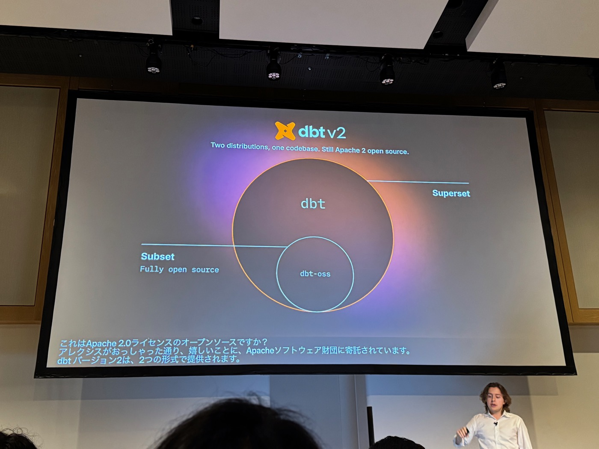
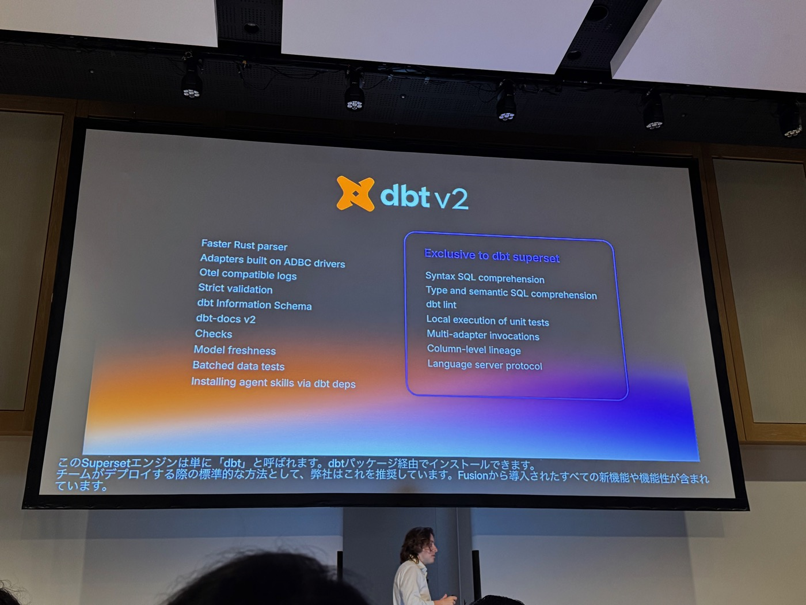
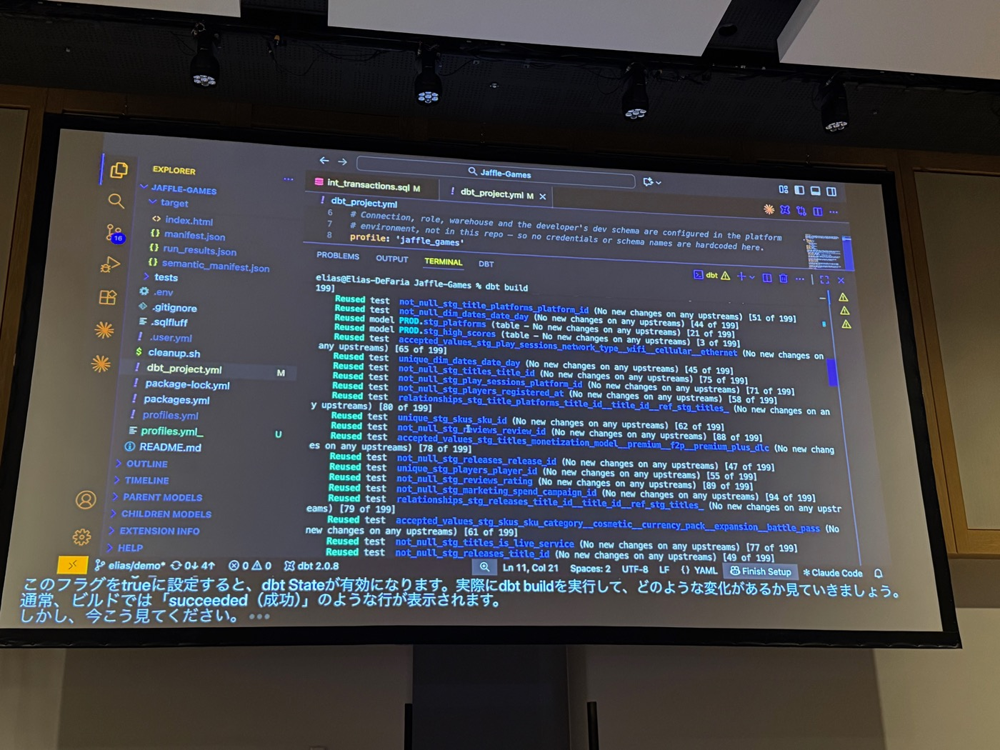
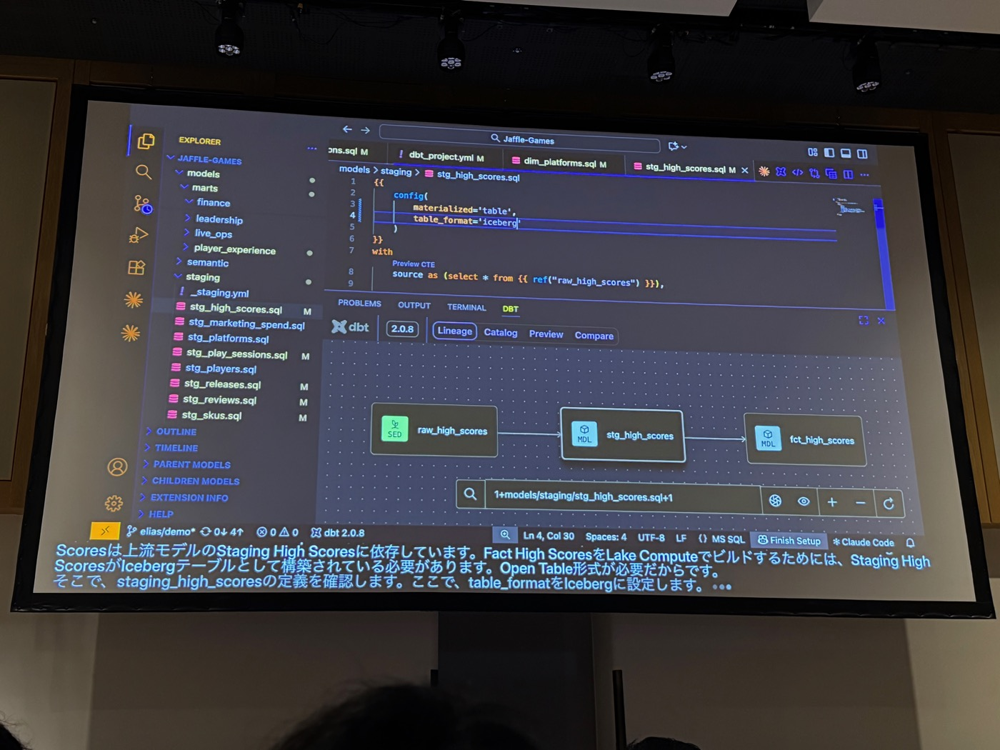


本文為 AI（Claude）協助產出的演講摘要：以現場錄音的逐字稿為底本，並以投影片照片交叉校正人名與數字後整理而成。內容雖經人工確認，仍可能與講者原意有出入，請以官方公開資料為準。


- **場次**：2026 dbt World Tour Tokyo（2026-10-20）
- **講者**：Elias DeFaria（Director, Product Management, dbt Labs——負責 dbt 引擎的產品）
- **素材**：現場錄音逐字稿（25 分鐘，英文演講附日文即時字幕）× 投影片照片 20 張

---

## 一、為什麼選「開放」當差異化

- 開場回到 keynote 的 **Open data infrastructure** 積木圖（Fivetran Managed Data Lake Service / Catalog & governance / Lake Compute 打底，中間 Fivetran connectors・dbt・Fivetran activations，上層 Metadata・Vector search・Semantic layer，頂層 BI & analytics・AI & agents）。
- 為什麼在擁擠的市場選「開放性」當差異化？因為**公司的歷史就是由它定義的**——dbt 是資料轉換的開源標準，是公司一切的核心。本場聚焦這塊積木：**dbt 引擎的投資與創新**。

## 二、dbt v1 → v2：引擎世代交替

以賽車規格卡呈現（投影片）：

| | dbt v1 | dbt v2.0 |
|---|---|---|
| 年齡 | 5 年 | **1 個月**（上月 GA） |
| 語言 | Python | **Rust** |
| 速度 | XS cold parse | Very fast |
| Off road | Go nuts! | **Guardrails** |

- **v1 政策**：不再加新功能（新功能與投資全進 v2），但 bug 修復與安全性修補**持續 3–5 年**，陪所有人過渡——「我們維護的是開源標準，不會棄守」。
- **v2 授權**：如 keynote 的 Alexis 所說，**基礎是 Apache 2 開源，並已寄託給 Apache 軟體基金會**。
- **兩種發行版、一套 codebase**：
  - **dbt-oss**（Subset）：純 Apache 2 開源碼，v1 能做的它都能做（完整 feature parity），只是用 Rust 重寫所以更快。
  - **dbt**（Superset）：經 dbt 套件安裝、官方推薦的預設部署形態，含 Fusion 帶來的所有新功能。

- **功能分佈**（投影片）：OSS 側——Faster Rust parser、ADBC driver 架構的 adapters、OTel 相容 logs、Strict validation、dbt Information Schema、dbt-docs v2、Checks、Model freshness、**Batched data tests**、經 dbt deps 安裝 agent skills。Superset 專屬——Syntax／Type and semantic SQL comprehension、**dbt lint**、**unit tests 本地執行**、**Multi-adapter invocations**、**Column-level lineage**、Language server protocol。

## 三、Live demo（Jaffle Games 專案、dbt 2.0.8、VS Code）

### 1. Parse 速度
`dbt parse` 快了幾個數量級——這是所有 dbt 操作提速的核心。

### 2. dbt lint（超快的 SQLFluff 相容 linter）
- `dbt lint` 原生內建於 v2，1.3 秒掃完專案抓出 18 個問題，VS Code extension 內行內顯示、可跳轉。
- **與 AI agent 的關係是重點**：「agent 讓產 code 變得便宜，但 code 品質的維護很昂貴——agent 不解決品質問題。所以需要 linter 這種**決定論工具**，在 agent 每次變更後把關 best practices。」`dbt lint --fix` 可自動修復。
- 設定沿用**既有的 .sqlfluff 檔與規則集**，零遷移成本；另新增 **5 條 dbt 專屬規則**（DBT01–05）：`dbt.import_ctes`、`dbt.join_condition_or`、`dbt.function_wrapped_filter_column`、`dbt.leading_wildcard_like`、`dbt.hard_coded_reference`。
  - `join_condition_or`：抓 JOIN 條件裡的 OR——它讓 Snowflake 等引擎無法做 hash join（equi join），查詢可能**慢 10 倍**。
  - `hard_coded_reference`：抓忘了用 `ref()`／`source()` 的硬編參照（「經典錯誤，我自己也犯過」）。

### 3. dbt checks（對專案 metadata 跑測試）
- 範例：`checks/all_models_have_owner.sql` —— `select unique_id from {{ info_schema('models') }} where coalesce(json_extract_string(meta, '$.owner'), '') = ''`。
- `dbt check` **0.01 秒**在本地跑完（像 data test，但查的是 dbt 專案 metadata）→ 抓到 `mart_monetization` 沒設 owner（上層的 `+meta: owner` 覆寫沒有往下傳播）→ 在 `_finance.yml` 補 `owner: finance` → 再跑即通過。可在 CI 與開發中強制執行。

### 4. dbt Information Schema ＋ dbt-docs v2
- `dbt compile --generate-info`（搭配 static analysis strict）後，target 目錄除了經典的 manifest.json、run_results.json，多了 **info_schema/ 資料夾**：dbt 專案 metadata 以 **parquet artifacts** 落地（dag_nodes、edges、column_lineage、checks、data_tests…十餘個檔），**可用 DuckDB 本地查詢**，連 column-level lineage 都有。
- `dbt serve` 開啟全新本地文件介面 **dbt-docs v2**：31 個 models、160 tests、13 metrics、2 semantic models 全列出；lineage 可視化、可分組，**欄位級 lineage**（如 platform_family 從 stg_platforms → dim_platforms）直接在本地 docs 看。

### 5. Batched data tests（v2 的智慧最佳化）
- 以往每個 data test 打一條 query：demo 專案 **156 條 query**。
- `dbt test --batch-tests`：同一模型的同類測試**智慧合併成一次掃描**（例：fct_transactions 的 5 個 not null 測試 → 1 條 query）。Demo 成績：**65 個可合併測試 → 21 條 query，執行時間減 30% 以上**。

### 6. Unit tests 本地執行（compute: local）
- 兩個 unit test 對比：1.22 秒 vs **0.08 秒**。後者在 YAML 設了 `compute: local`——把 Snowflake SQL **轉譯成 DuckDB SQL 在本地跑**，不打 warehouse。大幅降低成本、加快內圈開發迴圈。

### 7. dbt State
- dbt_project.yml 的 `manage_state` 開成 true → `dbt build` 的輸出從 succeeded 變成一排 **Reused**（199 項，模型與測試都「No new changes on any upstreams」跳過）——這就是驅動客戶 **15–30% 成本節省**的機制，跑在任何部署 dbt 的地方（demo 在筆電上，與雲端 state 服務對話）。

- **開發體驗**：新 dev schema（devcoolguy111）第一次 build `dim_platforms` → succeeded，但編譯後的 code 裡上游 ref **自動 defer 到 prod**——以往要手動拿 production 的 manifest.json、設 flag；現在**開箱即用**。
- 加上 `+` 重跑（`dbt run -s +dim_platforms`）→ 從沒在 dev 蓋過的 `stg_platforms` 竟顯示 **Reused**——因為 dbt State 偵測到其他環境已有最新版本，**自動跨環境 clone**，不浪費 compute。

### 8. Lake Compute（「這可能是今天宣布的最大的事」）
- 情境：`fct_high_scores` 每天建、資料量大、很貴。選項：換一家便宜的 warehouse（工程浩大）？重構 DAG（也費工且未必成功）？——或者**只把這一個模型搬到低成本的雲端 DuckDB**，專案其餘留在 Snowflake。
- 做法（各只要一行 config）：上游 `stg_high_scores` 設 `table_format = 'iceberg'`（Lake Compute 需要開放表格式）；下游 `fct_high_scores` 設 **`adapter = 'lakecompute'`**——在 DAG 中間切換引擎。

- 執行 `dbt run -s +fct_high_scores+`：stg_high_scores 以 Iceberg 重建（Snowflake，3.49s）→ fct_high_scores 提交到雲端 **auto-scaled DuckDB 執行**（20.32s），從 Iceberg 讀上游、寫回讓 Snowflake 的 Iceberg catalog 註冊 → 下游 `mart_player_leaderboard` 回到 Snowflake 跑（3.80s）。**一次 multi-adapter invocation**，3 模型全部成功。

## 四、收尾

v2 對 agent 更友善（lint／checks 當 guardrails）、本身更快（parse、batched tests、local unit tests），加上 dbt State 的智慧跳過與 Lake Compute 的按模型選引擎——這就是 dbt 引擎層對 Open Data Infrastructure 的投資。

---

### 附註：投影片與逐字稿互相校正的紀錄

- **講者**：投影片確認 **Elias DeFaria, Director, Product Management, dbt Labs**（demo 終端機 hostname `elias@Elias-DeFaria` 佐證）——正是其他場次提到的「Eliasのデモ」本人。
- **模型/指令名**：由 demo 畫面校正——mart_monetization（ASR: mark monetization）、stg_platforms／dim_platforms、stg_high_scores／fct_high_scores／mart_player_leaderboard（ASR: Mark Player leaderboard）、`dbt test --batch-tests`、`dbt lint --fix`、`adapter = 'lakecompute'`、devcoolguy111、`_finance.yml`、`compute: local`、linter 規則 DBT01–05 全名。
- **「part-play artifacts」**實為 **parquet artifacts**（target/info_schema/ 的 .parquet 檔清單可見）；「with.db」實為 **with DuckDB**。
- **「late compute」→ Lake Compute**（日文字幕直接寫 Lake Compute）；「ice-birm」→ Iceberg。
- **數字**：156 queries、65 tests→21 queries（-30%+）、1.22s vs 0.08s、199 reused、dbt 2.0.8——皆與 demo 畫面一致。
- 講者口誤「increases the cost of our unit tests」依語境與字幕修正為「increases the **speed**」。
- 末段兩句日文致謝為**司会**，已另標講者。
