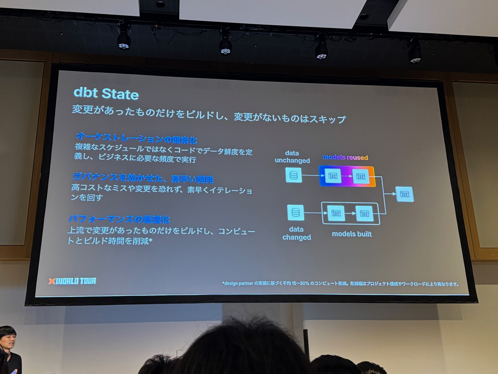
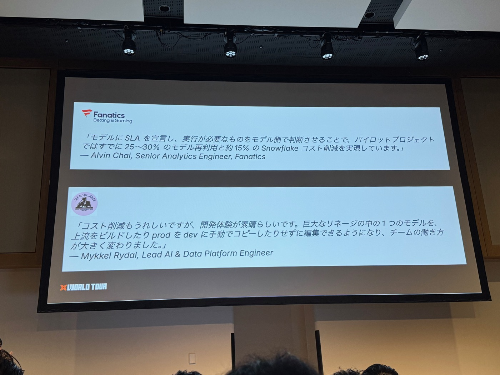
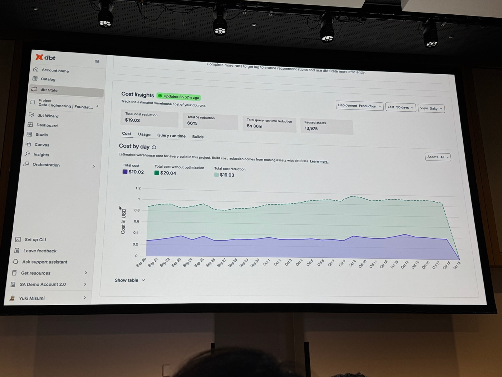
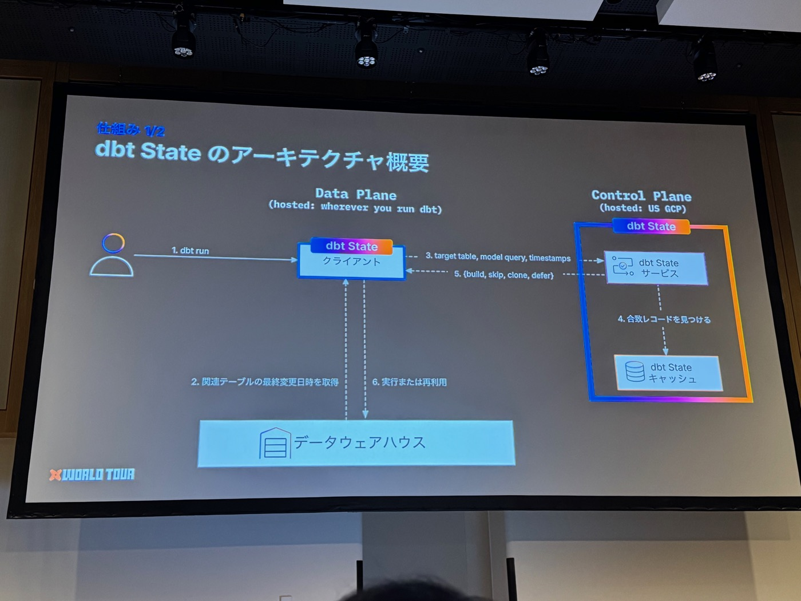


本文為 AI（Claude）協助產出的演講摘要：以現場錄音的逐字稿為底本，並以投影片照片交叉校正人名與數字後整理而成。內容雖經人工確認，仍可能與講者原意有出入，請以官方公開資料為準。


- **場次**：2026 dbt World Tour Tokyo（2026-10-20）
- **講者**：三角勇貴（Yuki Misumi，Partner Solutions Architect, dbt Labs）
- **副標（投影片）**：コンピュートの削減、データの鮮度向上、そしてより速い iteration を実現
- **素材**：現場錄音逐字稿（28 分鐘）× 投影片照片 22 張

---

## 一、背景：859k 個每日排程 job，大多在重跑沒變的東西

- dbt platform 上**每天有 859k 個排程執行的 dbt job**，其中多數情況下資料根本沒變——數千個模型為了同樣的結果被重複重建，浪費時間與 compute。
- 既往的對策是「把 job 弄複雜」：按時/日/週頻度拆多個 job、玩 `dbt run` 的 tag selector（`-s tag:hourly tag:daily…`）、管理 manifest 檔——還有各種落穴（例如 0 點時 hourly 和 daily job 同時打架，得設「job 1 在 0 點不跑」）。**compute 成本與 job 複雜度是蹺蹺板**，兩頭難兼顧。

## 二、dbt State 是什麼

**自動偵測模型變更、略過沒有變更的模型建置**。用了之後基本上只需要 `dbt build` 一條指令——不需要複雜 job、manifest、CLI flag。三大價值（投影片註：依 design partner 實績，**平均 15–30% compute 削減**）：

1. **Orchestration 簡素化**：資料鮮度用程式碼宣告，而不是用複雜排程實現。原本「每時/每日/每週」三個 job＋tag selector，改成**一個每時 job 跑 `dbt build`**，鮮度需求寫進模型 config：`lag_tolerance: 24h`（例：`fct_finance_daily`）——24 小時內上游變更不觸發重建，超過才 rebuild。
2. **Governance 下的快速開發**：dev 環境 build 時，dbt State 自動從 production **clone 上游模型**（不用全部重建、不用手動複製、不用管 manifest）——任何人都能低成本建出有治理的開發環境。「任何人」也包括 **AI agent**：agent 的機率性行為可能暴量跑模型，有 dbt State 當 guardrail，就算 agent 下了誇張的 `dbt build`，實際打到 warehouse 的只有變更部分。
3. **Performance 最適化**：上游有變更的才 build，減少 compute 與 build 時間。

## 三、客戶實證（投影片）

- **Fanatics Betting & Gaming**（Alvin Chai, Senior Analytics Engineer）：「在模型上宣告 SLA、讓模型自己判斷要不要跑——pilot 專案已實現 **25–30% 的模型再利用與約 15% 的 Snowflake 成本削減**。」
- **JOE & THE JUICE**（Mykkel Rydal, Lead AI & Data Platform Engineer）：「省成本當然開心，但**開發體驗**才是驚喜——巨大 lineage 裡的一個模型，不用 build 上游、不用手動把 prod 拷到 dev 就能直接編輯，團隊工作方式大幅改變。」

## 四、Demo（Jaffle Shop／VS Code／dbt 2.0.6／state_webinar_prod・dev schema）

1. **基本行為**：首次 `dbt build --target prod` 全部執行；立刻原樣重跑 → **16/16 全部 reused**——code 沒變、資料沒變就全 skip，而且**連 test 也一起 skip**（大量測試也不再是負擔）。
2. **Cosmetic edit 不觸發重建**：幫 orders 加 table alias、加註解 → 仍然 reused。dbt State 判斷這類「對結果資料毫無影響」的變更（cosmetic edit）不算變更。加一個 `Is Large Order` 欄位 → 這是有意義的變更 → orders 與下游 rebuild。
3. **lag_tolerance 實演**：對來源表 `raw_products` INSERT 一筆 → `dbt build` 後**只有 products 重建、其餘全部 reused**。原因：專案全域設 `lag_tolerance: 24h`（「多數模型晚一天沒關係」），products 個別設 `1m`（demo 用的緊 SLA）。
4. **`dbt state explain`**：每個模型「為什麼跑／為什麼 skip」都可追溯——三種分析（table analysis / query analysis / data freshness analysis），例如 order_items 判為 `SKIP_EXECUTION`（raw_products 雖 OUTDATED，但變更發生在 4 分鐘前、在 24h 容許內），products 判為 `READY_TO_EXECUTE`。
5. **Dev 環境秒建**：對空的 dev schema 跑 `dbt build` → 模型全部**從 prod clone**（staging 是 View、沒有實際資料，所以直接重建；table 則 clone），log 與 explain 都可確認。
6. **Platform 的 dbt State tab — Cost Insights**：顯示每日「實際成本 vs 若無 dbt State 的成本」（demo 帳面：30 天總削減 **$19.03、66%**、query 執行時間減 5h36m、reused assets 13,975）——可作日常監控，也可當正式導入前的評估依據。

## 五、仕組み（架構）

- **Data Plane**（你跑 dbt 的任何地方）＋ **Control Plane**（dbt State 服務，現駐美國 GCP）：
  ① 使用者 `dbt run` → ② dbt 客戶端向 warehouse 取相關表的最終更新時刻 → ③ 將 target table、model query、timestamps 送到 dbt State 服務 → ④ 服務對照 dbt State cache 中的過往執行紀錄 → ⑤ 回傳判斷 `{build, skip, clone, defer}` → ⑥ 客戶端執行或再利用。
- **判斷策略**（flowchart）：偵測 code／data 變更 → 「重建結果會不會變？」不變→ **skip**；會變 → 「其他環境有沒有同一張最新的表？」有→ **clone**；沒有→ **defer / build**。

## 六、主要設定

| 設定 | 作用 | 範例 |
|---|---|---|
| `lag_tolerance` | 距上次 build 在指定時間內不重建 | 支援 jinja 條件式：`{{ '4h' if target.name == 'prod' else '7d' }}`（prod 嚴、dev 鬆） |
| `require_fresh_data_from` | 上游「任一（any）」或「全部（all）」有新資料才重建 | 多來源 join 且全部都要最新時 → `all` |
| `allow_clones` | 是否允許從其他環境 clone 到目標 | 公司政策不許外環境 clone 進 prod → prod profile 設 `false` |

## 七、展望

1. **Lag tolerance recommendations**（已可用）：依過去 30 天執行實績，按模型推薦更省的設定值——例：`fct_orders_1` 現行 45m → 建議 24h，預估每月省 12 小時 build 時間（UI 表格含 % time saved、30 天預估）。
2. **Column-aware reuse**（檢討中）：程式碼變更時再往下看一層——**變更的欄位若未被下游使用，照樣 skip**。

## 八、開始使用

- **30 天免費 trial**；dbt platform 用戶與 **self-host（dbt v1/v2）用戶都能用**，platform 不需升級，開一個從量計費的 dbt 帳戶即可。
- v1.7–v1.12：`pip install dbt-state` → `dbt build`；v2.0.0+：`dbt login` → `dbt build`。

---

### 附註：投影片與逐字稿互相校正的紀錄

- **講者名**：ASR 的「三住」實為**三角勇貴**（標題投影片漢字＋demo 畫面帳號 Yuki Misumi 雙重確認；みすみ讀音相同）。頭銜為 Partner Solutions Architect。
- **客戶名**：ASR 的「Canatix」實為 **Fanatics**（Betting & Gaming）；「スマホレイプコスト」實為 **Snowflake コスト**；投影片補充 25–30% 模型再利用（逐字稿只聽到 15%）。另一家 JOE & THE JUICE 逐字稿完全沒聽清，由投影片補上。
- **859k**：ASR 的「85万9000件の量化が人工」實為「**每日排程執行的 dbt job 數 859k**」。
- **設定與指令名**：lag_tolerance（ラブトレランス等變體）、require_fresh_data_from、allow_clones、`dbt state explain`、SKIP_EXECUTION／READY_TO_EXECUTE、`pip install dbt-state` 均依投影片／demo 畫面校正。
- **demo 細節**：dbt 版本 2.0.6（逐字稿只說 version 2）、schema 名 state_webinar_prod/dev、Cost Insights 具體數字皆來自投影片。
- 結尾致謝被切成的 Speaker 2 已併回講者本人。
