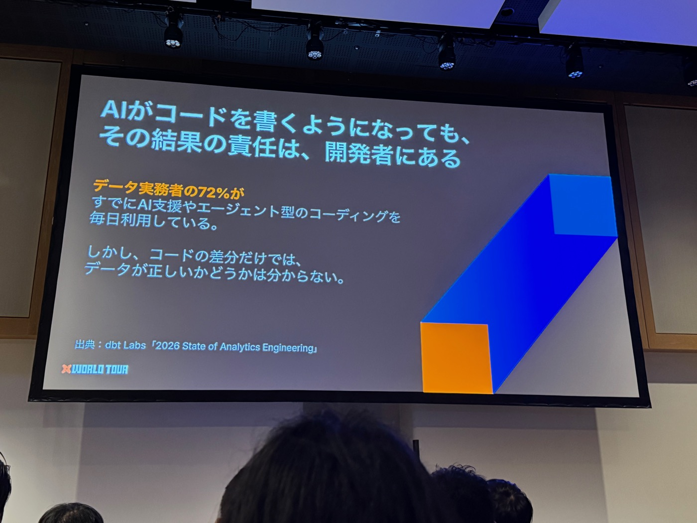
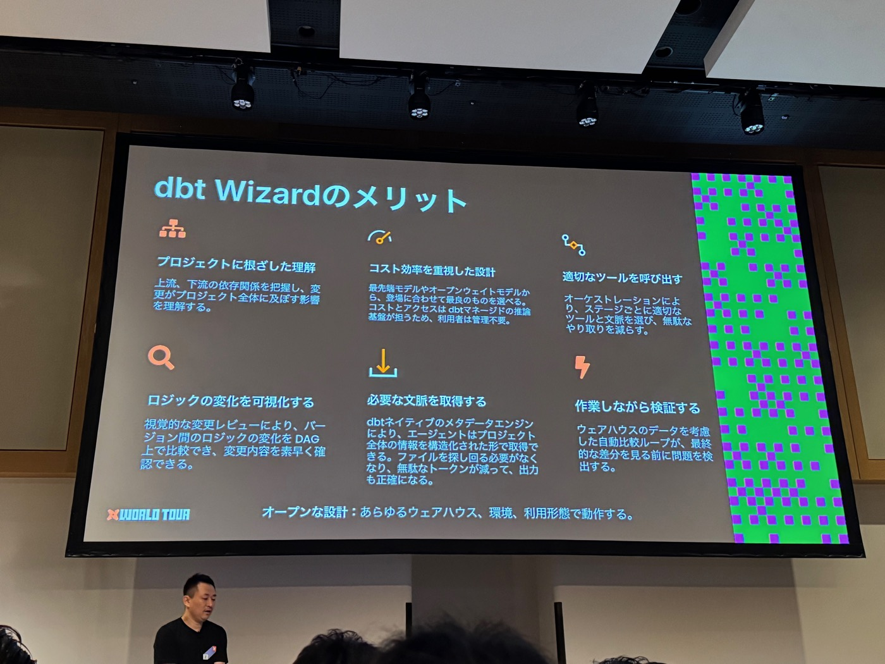
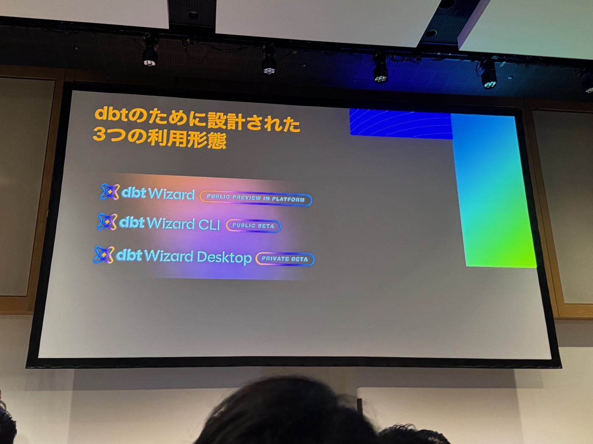
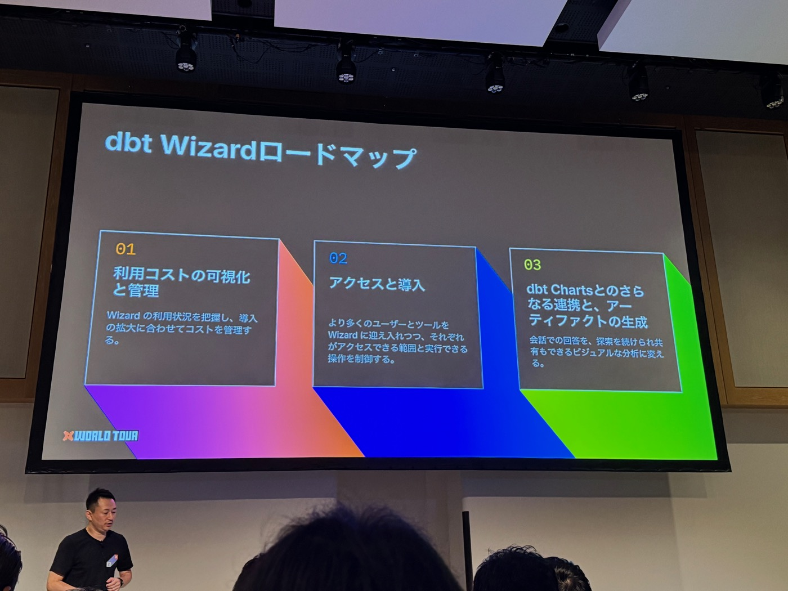


本文為 AI（Claude）協助產出的演講摘要：以現場錄音的逐字稿為底本，並以投影片照片交叉校正人名與數字後整理而成。內容雖經人工確認，仍可能與講者原意有出入，請以官方公開資料為準。


- **場次**：2026 dbt World Tour Tokyo（2026-10-20）
- **講者**：伊藤俊廷（dbt Labs Staff Solutions Architect，加入 dbt 近 6 年、APAC 第一號員工）
- **素材**：現場錄音逐字稿（31 分鐘）× 投影片照片 22 張

---

## 一、背景：AI 會寫 code，但責任還在人身上

- dbt Labs《2026 State of Analytics Engineering》調查：**72% 的資料從業者已每天使用 AI 輔助或代理式（agentic）編碼**。
- 核心問題：**「只看程式碼 diff，無法判斷資料是否正確」**。AI 產出的程式碼，最終仍由 PR 負責人（人類）承擔責任。
- 通用型 AI agent 以「程式碼」為中心，分析工程師必須自行補上三種脈絡：
  1. **專案文脈**——這段邏輯在這個專案裡代表什麼意義？
  2. **下游影響**——這個變更還會波及哪些模型？
  3. **資料驗證**——含下游模型在內，結果現在仍然正確嗎？
- 工具分散的痛點：warehouse console、BI、Slack、GitHub、notebook、VS Code……開發者得跨多個 app 自行拼湊資訊（投影片用了 Pepe Silvia 迷因自嘲）。

- AI 帶來的開發迴圈變化：傳統上「實裝→作成→測試→審查」一圈由人推動要數日、同時只跑 1–2 條；現在 agent 數分鐘跑完一圈、多假說並行、可自律重複多圈——**高並行開發成為常態**，瓶頸轉移到：
  - 實裝/測試：**正確脈絡的提供**（定義、依存關係、期望值沒傳對，就會「用錯的基準驗證錯的東西還通過」）
  - 作成：**高效率的模型執行**（重跑無關範圍浪費時間與成本 → 由 keynote 介紹的 **dbt State** 解決）
  - 審查：**「改了什麼」的可判斷性**（差分、影響範圍、修正後狀態）

## 二、dbt Wizard 是什麼：dbt 專用 AI agent 的六大設計

1. **根植於專案的理解**：掌握上下游依存關係與變更的全專案影響。
2. **成本效率導向**：可選最先進模型或 open-weight 模型，由 dbt managed 推論基盤承擔成本與存取管理，使用者免自行維運。
3. **適切地呼叫工具**：依工作階段（orchestration）挑選合適工具與脈絡，減少無謂往返。
4. **邏輯變化可視化**：以版本間 **DAG 比較**做視覺化變更審查，快速確認改了什麼。
5. **取得必要文脈**：dbt 原生 metadata engine 讓 agent 以結構化方式取得全專案資訊——不必翻檔案、省 token、輸出更準。
6. **邊作業邊驗證**：納入 warehouse 實際資料的自動比較迴圈，在人看到最終差分前先攔截問題。

底線：**開放設計**——任何 warehouse、環境、利用形態都能用。

## 三、三種（＋一個新模式）利用形態

| 形態 | 狀態 | 重點 |
|---|---|---|
| **dbt Wizard**（Platform 內） | Public Preview | Studio 或 Home tab 直接用；跨多檔案的建構與重構；程式碼＋測試＋文件一併更新；對開發資料驗證；以 code 或 DAG 審查變更 |
| **Wizard Explore Mode** | Public Preview（NEW） | 給商業使用者／分析師的**閱覽專用**模式：取 metrics、跑查詢、畫圖；不可寫入（不能編輯檔案、commit、開 PR、dbt build）；管理者可一律設定 read-only 的 DWH 認證、控管可存取的模型——定位是「BI 的替代入口」 |
| **dbt Wizard CLI** | Public Beta | 終端機中心工作流；**dbt v1（舊 dbt Core）與 self-host 使用者也能用**；本地專案直接動；一個 session 內完成作成→執行→驗證 |
| **dbt Wizard Desktop** | Private Beta（NEW，本場主角） | 長時間任務專用的本地工作區：**多條 agent thread 並行**，每條 thread 以獨立 branch＋schema 隔離（類似 CI 的做法）互不干擾；code／data／lineage／terminal 一個畫面；主導 release 前驗證 |

## 四、客戶實證

Endress+Hauser Infoserve 的資料科學家 Erion Krasniqi：

> 「導入 dbt Wizard 前，工程師花在修正 AI 輸出的時間比寫 model 還多。現在 agent 真正理解專案——join 寫得對、遵守 contract、不會弄壞下游。**導入以來，正式環境的 incident 減少了 15–20%**。」

## 五、Demo：jaffle_games（虛構遊戲公司）

環境：Snowflake × dbt Platform，semantic layer 已定義好 metrics。關鍵設定：遊戲設計師與商業使用者對「active player」定義不同（前者在乎遊玩時數、後者在乎活躍率）——正是「脈絡」重要性的縮影。

**情境 1：盤點與探索（Wizard Desktop）**
- 問「目前用哪些 metrics 衡量玩家 engagement」→ agent 用 dbt 專用 skill 檢索 semantic layer，列出既有 metrics，可直接看 lineage 與前後關係；右側有 metrics 專用 tab，點選即取數——比一般 AI 聊天快得多。
- 商業使用者臨時插單（想看 active player 與留存的相關性）→ **fork chat**：繼承原 context 分出新 thread，branch 與 schema 自動分離，不破壞原本進行中的開發；兩張圖出來後確認相關性，過往圖表還能從歷史回溯。

**情境 2：修改開發＋CI/CD（承上）**
- 遊戲設計師追加需求：「玩超過 1 小時的玩家要另外定義」→ agent 搜尋 metadata、提出實作方案；每次實作都附上 **assumptions／expectations 的條列說明**＋可即看的 diff。
- 過程中發現 crash flag 欄位沒被用上 → 在對話中針對該點 comment 追問 → agent 修正 dbt model 的 SQL。
- **Validate**：跑 unit test 之外，還加了自訂驗證規則——「與 production 相比差異超過 5% 即失敗」——全綠後確認變更無預期外影響。
- **Create Pull Request** → push GitHub、依專案設定的 PR 模板產生說明（前提／期待結果固定格式，方便 reviewer）；commit 後在 Desktop 的 **Checks tab** 直接看 CI job 結果，並有跳轉 PR／CI 的按鈕。
- 畫面細節：模型選擇器可切換（demo 中出現 GPT-5.6 Luna、Claude Sonnet 4.6），支援 MCP。

## 六、Roadmap

1. **利用成本的可視化與管理**——掌握 Wizard 使用狀況，隨導入擴大控管成本（目前僅有簡單版）。
2. **存取與導入**——更細緻的權限設定：哪些使用者能用到什麼範圍、能執行什麼操作。
3. **與 dbt Charts 的深度整合＋artifact 生成**——dbt Charts（9 月發布）把 BI／AI agent 顯示的圖表定義也納入 dbt 程式碼管理，確保任何工具畫出同一張圖；未來把對話回答轉成「可繼續探索、可分享」的視覺分析。

## 七、開始使用

- **Platform 版**：帳戶設定啟用 AI 功能 → dbt Studio 的 Wizard tab，或 Home tab 的 dbt Wizard。
- **CLI**：`curl -fsSL https://public.cdn.getdbt.com/dbt-wizard/install/install-wizard.sh | sh`（self-host 或 managed 都可）。
- **Desktop**：掃投影片 QR code 申請 Private Beta。

---

### 附註：投影片與逐字稿互相校正的紀錄

- 講者名：ASR 轉成「伊藤義孝」，投影片確認為**伊藤俊廷**（已回寫逐字稿）。
- 客戶名：ASR 的「エンドレス、ハーザーのITコーナー社」實為 **Endress+Hauser Infoserve**（已回寫）。
- Demo 專案：ASR 的「Jahoo Game」實為 **jaffle_games**（dbt 經典範例 Jaffle Shop 的遊戲版）。
- 「DVTステート／ステージ」經查證為 keynote 介紹的 **dbt State**（原 state-aware orchestration，Fusion 專案的 Preview 功能）。
